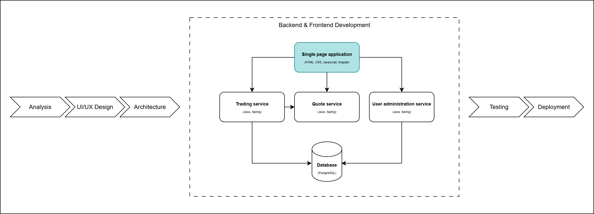

# Frontend Development: Create Login and Register Pages with Angular



**Goal:** build registration, login, protected navigation, and a not-found page. Everyone can complete this laboratory with the supplied mock server. Java services, PostgreSQL, and completed backend laboratories are not prerequisites. Real backend integration is an optional extension at the end.

For this laboratory to work, it's essential to have Node.js, npm, and the Angular CLI installed on your machine. Node.js enables server-side JavaScript execution, while npm helps manage project dependencies. The Angular CLI is a command-line tool that simplifies the development of Angular applications. If you haven't installed these yet, you can download Node.js and npm from the official  [Node.js](https://nodejs.org/) website and install the [Angular CLI](https://angular.dev/installation#install-angular-cli) using npm.

**IMPORTANT**: This laboratory uses Angular 21. Node.js 24 is recommended; an existing Node.js 22 installation at version 22.12 or newer also works. Check which Node.js you have:

```bash
node -v
```

If Node.js is missing or you do not have one of those supported versions, install Node.js 24:

- **Windows and macOS**: download the **24 LTS** installer from [nodejs.org](https://nodejs.org/en/download) and run it. It replaces an older version and includes npm.
- **Linux**: install it with your package manager, or follow the instructions for your distribution on the same page.
- If you already use a version manager such as `nvm` (or `nvm-windows`), run `nvm install 24` and then `nvm use 24`.

After installing, close and reopen the terminal, then run `node -v` again: it should print `v24.x.x`. If you already have a supported Node.js 22 version, keep it.

Then install Angular CLI version 21 globally, to avoid compatibility issues with the commands used in this laboratory:

```bash
npm install -g @angular/cli@21
```

To verify your Angular CLI version, run:

```bash
ng version
```

If you missed the previous laboratories, you'll also need to install [Git](https://git-scm.com/) and clone the project repository using the command below, or download it directly from GitHub:

```bash
git clone https://github.com/webtoknow/fx-trading-app.git
```

> To run the supplied solution or switch between mocks and Java services, see [Local frontend setup](../../FRONTEND_LABS.md).

## Table of contents
- [Exercise 0 - Configure and start Mock Server](#exercise-0---configure-and-start-mock-server)
- [Exercise 0.1 - Configure UI Reverse Proxy](#exercise-01---configure-ui-reverse-proxy)
- [Exercise 1 - Pages, Routing and Navigation](#exercise-1---pages-routing-and-navigation)
  - [Create pages](#create-pages)
  - [Add routes](#add-routes)
  - [Add Toastr](#add-toastr)
  - [Fill in global style file](#fill-in-global-style-file)
  - [Add Bootstrap, Datepicker and Fontawesome](#add-bootstrap-datepicker-and-fontawesome)
- [Exercise 2 - Register page](#exercise-2---register-page)
  - [User model](#user-model)
  - [Constants file](#constants-file)
  - [User service](#user-service)
  - [Provide the HTTP client](#provide-the-http-client)
  - [Register component](#register-component)
- [Exercise 3 - Login page](#exercise-3---login-page)
  - [Authentication service](#authentication-service)
  - [Authentication guard](#authentication-guard)
  - [JWT Interceptor](#jwt-interceptor)
  - [Error Interceptor](#error-interceptor)
  - [Register the interceptors](#register-the-interceptors)
  - [Login component](#login-component)
- [Exercise 4 - Not found page](#exercise-4---not-found-page)
- [Done when](#done-when)
- [Optional - Connect to the real backend](#optional---connect-to-the-real-backend)

## Exercise 0 - Configure and start Mock Server

Use the supplied mock server for the exercises below. It provides the same registration and login endpoints as the Java user-administration service. The authentication handler is already provided in `server.js`; you do not need to write backend code in this laboratory.

In **terminal 1**, from the directory containing your cloned `fx-trading-app` folder, install and start the mocks:

```bash
cd fx-trading-app/06_Frontend_Development/Exercise/Code/mock-server
npm ci
npm start
```

Leave this terminal running. Registration and login use port **8200**. The start command also runs the JSON Server APIs on **8210** and **8220**, which are used in laboratory 07.

### Optional shortcut: start mocks from the UI folder

For convenience, you can add an npm script to your **ui/package.json** that allows you to start the mock server from the UI folder:

```json
"scripts": {
  "ng": "ng",
  "start": "ng serve",
  "start:mock": "cd ../mock-server && npm start",
  "build": "ng build",
  ...
}
```

After installing the mock packages above, you can use this command instead of starting them from the mock folder. Stop the first mock process before using this shortcut, and use a separate terminal from the UI server:

```bash
cd fx-trading-app/06_Frontend_Development/Exercise/Code/ui
npm run start:mock
```

Now we can access these APIs:

- `http://localhost:8200/user/authenticate` - sign-in
- `http://localhost:8200/user/register` - register
- `http://localhost:8210/transactions` - get all transactions
- `http://localhost:8220/currencies` - get all currencies
- `http://localhost:8220/fx-rate` - get fx rates for specific currencies

The mock login is `student` / `student123`. You will also create a new account when testing the registration page. Keep using mocks through Exercise 4; the [optional backend extension](#optional---connect-to-the-real-backend) comes afterwards.

## Exercise 0.1 - Configure UI Reverse Proxy

Use a development proxy to connect the UI to the mocks. The same configuration also works with the optional Java backend. The browser calls the Angular server on port 4200, which forwards API requests to ports 8200–8220. This keeps browser requests on the same origin and avoids a separate CORS setup.

### Step 1: Create proxy configuration file

Create a file called **proxy.conf.json** under the **ui/** folder with the following content:

```json
{
    "/auth/**": {
        "target": "http://127.0.0.1:8200",
        "secure": false,
        "changeOrigin": true,
        "logLevel": "debug",
        "pathRewrite": {
            "^/auth": ""
        }
    },
    "/trade/**": {
        "target": "http://127.0.0.1:8210",
        "secure": false,
        "changeOrigin": true,
        "logLevel": "debug",
        "pathRewrite": {
            "^/trade": ""
        }
    },
    "/quote/**": {
        "target": "http://127.0.0.1:8220",
        "secure": false,
        "changeOrigin": true,
        "logLevel": "debug",
        "pathRewrite": {
            "^/quote": ""
        }
    }
}
```

**Explanation**:
This configuration intercepts requests below `/auth/**`, `/trade/**`, and `/quote/**` and forwards them to the corresponding backend services running on different ports:
- `/auth` → http://localhost:8200 (User Administration Service)
- `/trade` → http://localhost:8210 (FX Trading Service)
- `/quote` → http://localhost:8220 (Quote Service)

The `/**` patterns include nested endpoints such as `/auth/user/register`. The **pathRewrite** option ensures the backend receives requests without the initial path prefixes, while **changeOrigin: true** adjusts the request headers for proper routing.

Use `npm start` to enable this proxy. Restart the dev server after changing `proxy.conf.json`. These settings apply to local development; a production host must provide its own API routing. See [Angular proxy documentation](https://angular.dev/tools/cli/serve#proxying-to-a-backend-server).

### Step 2: Update the start script

Change the start script in **package.json** to use the proxy configuration:

```json
"start": "ng serve --proxy-config proxy.conf.json"
```

### Step 3: Use the proxy paths and test the connection

These two steps need files that are created later in this laboratory, so you will do them there:

- *Use the proxy paths in the UI*: at the end of [Constants file](#constants-file), once `constants.ts` exists.
- *Test the integration*: at the end of [Exercise 3 - Login page](#exercise-3---login-page), once the register and login pages exist.

Use the proxy paths for both modes. Switching between mocks and real services only requires stopping one set of APIs and starting the other; no edit to `constants.ts` is needed.

## Exercise 1 - Pages, Routing and Navigation

### Create pages

Go to *06_Frontend_Development/Exercise/Code/ui* using a new **terminal** window:

```bash
cd fx-trading-app/06_Frontend_Development/Exercise/Code/ui
```

> In the `public` directory, you'll find several images, such as `favicon.ico`, as well as the following under the `assets/img/` folder: `error_404.png`, `logo-grayscale.svg`, and `logo-main.svg`.

Run `npm ci` to install the dependencies from the supplied lockfile:

```bash
npm ci
```

Create a folder for pages in *ui/src/app*:

```bash
cd src/app
mkdir pages
cd pages
```

Generate page components using CLI:

```bash
ng generate component dashboard-page
ng generate component login-page
ng generate component not-found-page
ng generate component register-page
```

Each command creates a standalone component: a component that lists what it uses in its own `imports`, so nothing else has to register it. Each command also creates a `*.spec.ts` file (a unit test) next to the component. The generated tests are only a starting point: you will replace them with real ones, collapsed in the `<details>` blocks below. **Paste each spec file when you reach it, but run `ng test` only at the end** (see [Done when](#done-when)): the specs import `AuthenticationService`, which you create in Exercise 3.

The dashboard page stays a placeholder in this laboratory (`dashboard-page works!`), so its spec is the only thing you change in it now. Replace the content of `dashboard-page.component.spec.ts`:

<details>
<summary>dashboard-page.component.spec.ts</summary>

```TypeScript
import { provideHttpClient } from '@angular/common/http';
import { provideHttpClientTesting } from '@angular/common/http/testing';
import { NO_ERRORS_SCHEMA } from '@angular/core';
import { FormsModule, ReactiveFormsModule } from '@angular/forms';
import { provideRouter } from '@angular/router';
import { ToastrModule } from 'ngx-toastr';
import { BsDatepickerModule } from 'ngx-bootstrap/datepicker';
import { UserService } from '../../services/user.service';
import { AuthenticationService } from '../../services/authentication.service';
import { ComponentFixture, TestBed } from '@angular/core/testing';

import { DashboardPageComponent } from './dashboard-page.component';

describe('DashboardPageComponent', () => {
  let component: DashboardPageComponent;
  let fixture: ComponentFixture<DashboardPageComponent>;

  beforeEach(async () => {
    await TestBed.configureTestingModule({
      imports: [DashboardPageComponent, FormsModule, ReactiveFormsModule, ToastrModule.forRoot(), BsDatepickerModule],
      providers: [provideHttpClient(), provideHttpClientTesting(), provideRouter([]), UserService, AuthenticationService],
      schemas: [NO_ERRORS_SCHEMA]
    })
    .compileComponents();

    fixture = TestBed.createComponent(DashboardPageComponent);
    component = fixture.componentInstance;
    fixture.detectChanges();
  });

  it('should create', () => {
    expect(component).toBeTruthy();
  });
});
```

</details>

### Add routes

In `app.routes.ts`, import all the necessary components to make them available for routing. After that, fill in the `routes` array by linking each of the components. `app.config.ts` already passes these routes to the router with `provideRouter(routes)`.

```JS
import { Routes } from '@angular/router';

import { LoginPageComponent } from './pages/login-page/login-page.component';
import { RegisterPageComponent } from './pages/register-page/register-page.component';
import { DashboardPageComponent } from './pages/dashboard-page/dashboard-page.component';
import { NotFoundPageComponent } from './pages/not-found-page/not-found-page.component';

export const routes: Routes = [
  { path: '', redirectTo: '/login', pathMatch: 'full' },
  { path: 'login', component: LoginPageComponent },
  { path: 'register', component: RegisterPageComponent },
  { path: 'dashboard', component: DashboardPageComponent },
  { path: '**', component: NotFoundPageComponent }
];
```
Now we need to clean up the project by:
- Deleting everything in *app.component.html* (the whole startup page) and leaving only `<router-outlet></router-outlet>`.
- Removing `title = 'ui'` from AppComponent in *app.component.ts*.
- Replacing the content of *app.component.spec.ts*: the generated tests check the `title` and the `<h1>` you just removed, so they would fail. Keep only the test that checks that the component is created:

<details>
<summary>app.component.spec.ts</summary>

```TypeScript
import { TestBed } from '@angular/core/testing';
import { provideRouter } from '@angular/router';
import { AppComponent } from './app.component';

describe('AppComponent', () => {
  beforeEach(async () => {
    await TestBed.configureTestingModule({
      imports: [AppComponent],
      providers: [provideRouter([])],
    }).compileComponents();
  });

  it('should create the app', () => {
    const fixture = TestBed.createComponent(AppComponent);
    const app = fixture.componentInstance;
    expect(app).toBeTruthy();
  });
});
```

</details>

Great job! 👍👍 Now, let's view your first Angular application by starting the development server in a **terminal** window.

Use the previously opened terminal and ensure you're in the *fx-trading-app/06_Frontend_Development/Exercise/Code/ui* directory. You can navigate to this directory with the following commands:

```bash
cd ..
cd ..
cd ..
```

Once you're in the root folder of your Angular application (*06_Frontend_Development/Exercise/Code/ui*), run:

```bash
npm start
```
After the build process completes in the terminal, you can access the app by opening a browser (such as Chrome) and navigating to `http://localhost:4200/`. You should see the message:

```
login-page works!
```


### Add Toastr

We are using [ngx-toastr](https://github.com/scttcper/ngx-toastr) for notifications. 

Install *ngx-toastr*:

```bash
npm install ngx-toastr@20.0.5
```

In order to load *toast* style, we should update `angular.json`. Find the `styles` array of the `build` target (`projects` > `ui` > `architect` > `build` > `options` > `styles`; not the one under `test`) and add the toastr stylesheet to it:

```JSON
"styles": [
  "src/styles.css",
  "node_modules/ngx-toastr/toastr.css"
]
```

We also need to update `app.config.ts`: add `provideAnimations()` (Toastr animates its messages) and `provideToastr()`:

```JS
import { ApplicationConfig, provideZoneChangeDetection } from '@angular/core';
import { provideRouter } from '@angular/router';
import { provideAnimations } from '@angular/platform-browser/animations';
import { provideToastr } from 'ngx-toastr';

import { routes } from './app.routes';

export const appConfig: ApplicationConfig = {
  providers: [
    provideZoneChangeDetection({ eventCoalescing: true }),
    provideRouter(routes),
    provideAnimations(),
    provideToastr()
  ]
};
```
This will ensure both Toastr notifications and animations are properly configured in the application.

For more information on how to use `ngx-toastr`, you can refer to the official documentation available on [GitHub](https://github.com/scttcper/ngx-toastr). There, you'll find detailed instructions on installation, configuration, and examples of how to display notifications in your Angular application.

To verify that you’ve correctly added `ngx-toastr`, replace the contents of `app.component.ts` with the following code:

```JS
import { Component, OnInit } from '@angular/core';
import { RouterOutlet } from '@angular/router';
import { ToastrService } from 'ngx-toastr';

@Component({
  selector: 'app-root',
  imports: [RouterOutlet],
  templateUrl: './app.component.html',
  styleUrl: './app.component.css'
})
export class AppComponent implements OnInit {
  constructor(private toastr: ToastrService) {}

  ngOnInit() {
    this.showSuccess();
  }

  showSuccess() {
    this.toastr.success('Hello world!', 'Toastr fun!');
  }
}
```
After making this change, refresh the browser, and you should see the toastr notification displayed. Please remember to revert the file once you’ve completed testing. It must end up like this:

```JS
import { Component } from '@angular/core';
import { RouterOutlet } from '@angular/router';

@Component({
  selector: 'app-root',
  imports: [RouterOutlet],
  templateUrl: './app.component.html',
  styleUrl: './app.component.css'
})
export class AppComponent {
}
```

### Fill in global style file

Open `styles.css` global style file and fill in with these classes, used in the whole application, not only in one specific component:

```CSS
/* You can add global styles to this file, and also import other style files */

html, body{
    height: 100%;
    color: #373A3C;
    font-family: 'Open Sans', sans-serif;
}

h1,h2,h3,h4,h5,h6 {
    color: #7C7C7C;
}

.btn-primary {
    background-color: #3496F0;
}

.btn-link {
    color: #3496F0;
}
.table-striped tbody tr:nth-of-type(odd) {
    background-color: #F2F2F2;
}

.flex {
    display: flex;
}

.flex-vertical-centered {
    display: flex;
    align-items: center;
}

.title {
    margin-bottom: 30px;
    padding-bottom: 20px;
    font-weight: bold;
}

.title-border {
    border-bottom: 1px solid #DDDDDD;
}

.screen-full-height {
    height: 100vh;
    display: flex;
}

.is-invalid {
  border-left: 5px solid #D9534F;
}
```

### Add Bootstrap, Datepicker and Fontawesome

The application uses the Open Sans font from Google Fonts. Add these links at the end of the `<head>` tag of `index.html`, after the `favicon` link:

```HTML
  <link rel="preconnect" href="https://fonts.googleapis.com">
  <link rel="preconnect" href="https://fonts.gstatic.com" crossorigin>
  <link href="https://fonts.googleapis.com/css2?family=Open+Sans:wght@400;700&display=swap" rel="stylesheet">
```

Bootstrap (layout and form styles), Font Awesome (icons) and `ngx-bootstrap` (the datepicker) are installed as packages, like any other dependency of the project:

```bash
npm install bootstrap@5.3.8 font-awesome@4.7.0 ngx-bootstrap@21.2.2
```

There is nothing to register for `ngx-bootstrap` now: the component that uses the datepicker (the blotter, in the next laboratory) imports `BsDatepickerModule` itself.

Load their stylesheets by updating the same `styles` array in `angular.json`. Bootstrap and Font Awesome come first, so that our own `src/styles.css` can override them:

```JSON
"styles": [
  "node_modules/bootstrap/dist/css/bootstrap.min.css",
  "node_modules/font-awesome/css/font-awesome.min.css",
  "src/styles.css",
  "node_modules/ngx-toastr/toastr.css",
  "node_modules/ngx-bootstrap/datepicker/bs-datepicker.css"
]
```

## Exercise 2 - Register page

### User model

First, let's create a new folder in *06_Frontend_Development/Exercise/Code/ui/src/app* called **models** to store all the entities we'll need.

From the design of the register page, we can identify the necessary fields for the user:
* id
* username
* email
* password

Next, create a new file named `user.ts` in the models folder and define the following class:

```JavaScript
export class User {
    id: number | null = null;
    username: string = '';
    email: string = '';
    password: string = '';
}
```

### Constants file

To communicate with the backend, we will need to define the necessary APIs. Let's establish how these APIs will be structured.

On the server side, there will be three microservices:

- *authService*, running on port 8200
- *fxTradeService*, running on port 8210
- *quoteService*, running on port 8220

In the directory *06_Frontend_Development/Exercise/Code/ui/src/app*, we will create a new file named `constants.ts`, which will hold all the required API endpoints:


```JavaScript
export const authApi = '/auth'
export const tradeApi = '/trade'
export const quoteApi = '/quote'

export const backendUrl = {
  authService: {
    authenticate: `${authApi}/user/authenticate`,
    register: `${authApi}/user/register`,
  },
  fxTradeService: {
    getTransactions: `${tradeApi}/transactions`,
    saveTransaction: `${tradeApi}/transactions`,
  },
  quoteService: {
    getCurrencies: `${quoteApi}/currencies`,
    getFxRate: `${quoteApi}/fx-rate`
  }
}
```

#### Use the proxy paths (Exercise 0.1, Step 3)

Keep the first three lines of **ui/src/app/constants.ts** as shown above. These prefixes match the proxy configuration for both backend modes:

```JavaScript
export const authApi = '/auth'
export const tradeApi = '/trade'
export const quoteApi = '/quote'
```

_For simplicity, we are using a constants file for the service URLs. In a production deployment, these URLs would be determined dynamically based on the target environment, resulting in a more specific configuration process (https://angular.dev/tools/cli/environments)_

### User service

Now, let's focus on creating the service to send user details via an HTTP request to the server.

Start by creating a new folder in *06_Frontend_Development/Exercise/Code/ui/src/app* named **services**, which will hold all the services required for different functionalities.

Our first service will be in a file called `user.service.ts`:

```JavaScript
import { Injectable } from '@angular/core';
import { HttpClient } from '@angular/common/http';
import { Observable } from 'rxjs';

import { User } from '../models/user';
import { backendUrl } from '../constants';

@Injectable({ providedIn: 'root' })
export class UserService {
  constructor(private http: HttpClient) { }

  // The backend answers POST /user/register with an empty body
  register(user: User): Observable<void> {
    return this.http.post<void>(backendUrl.authService.register, user);
  }

}
```

Here's what the service does:
* The constructor injects `HttpClient`, enabling the service to make HTTP requests.
* The register method accepts a User object (the user data to be sent for account creation) and makes a `POST` request to the API URL defined in `constants.ts` (backendUrl.authService.register), passing the user as the request body.
* `register` returns an `Observable<void>`: an Observable is a value that arrives later (here, the answer of the server). The backend answers this request with an empty body, so there is nothing to read from the response, and we say so in the type (`post<void>`) instead of using `any`. The component that calls `register` gets the answer by subscribing, as you will see below.

This service allows us to communicate with the backend to register new users.

### Provide the HTTP client

In `app.config.ts`, add `provideHttpClient()` right after `provideRouter(routes)`, so that services can use `HttpClient`:

```TypeScript
import { provideHttpClient } from '@angular/common/http';
...
  providers: [
    ...
    provideHttpClient()
  ]
```

`UserService` needs no registration: `@Injectable({ providedIn: 'root' })` makes Angular create it the first time a component asks for it. The forms modules are not registered here either: the register and login pages import `ReactiveFormsModule` in their own `imports`.

### Register component

We have already set up the necessary files for the registration functionality. Now, let's fill in the code to make it work.

**register-page.component.html**:

```HTML
<div class="screen-full-height">
  <aside class="col-md-6 login-logo-container container-center">
    
  </aside>
  <main class="col-md-6">
    <article class="container-center screen-full-height">
      <div class="content">
        <h1 class="title title-border">Register a new account</h1>
        <form id="register" [formGroup]="registerForm" (ngSubmit)="onSubmit()">
          <p class="mb-3">
            <label for="username">Username</label>
            <input
              type="text"
              class="form-control form-control-sm"
              id="inputUsername"
              formControlName="username"
              placeholder="username"
              autocomplete="username"
              [ngClass]="{ 'is-invalid': submitted() && f['username'].errors }"
              />
            @if (submitted() && f['username'].errors) {
              <span
                class="invalid-feedback"
                >
                @if (f['username'].errors['required']) {
                  <span
                    >Username is required!</span
                    >
                  }
                </span>
              }
            </p>
            <p class="mb-3">
              <label for="email">Email</label>
              <input
                type="text"
                class="form-control form-control-sm"
                id="inputEmail"
                formControlName="email"
                placeholder="email address"
                [ngClass]="{ 'is-invalid': submitted() && f['email'].errors }"
                />
              @if (submitted() && f['email'].errors) {
                <span
                  class="invalid-feedback"
                  >
                  @if (f['email'].errors['required']) {
                    <span>
                      Email is required!
                    </span>
                  }
                </span>
              }
            </p>
            <p class="mb-3">
              <label for="password">Password</label>
              <input
                type="password"
                class="form-control form-control-sm"
                id="inputPassword"
                formControlName="password"
                placeholder="password"
                autocomplete="new-password"
                [ngClass]="{ 'is-invalid': submitted() && f['password'].errors }"
                />
              @if (submitted() && f['password'].errors) {
                <span
                  class="invalid-feedback"
                  >
                  @if (f['password'].errors['required']) {
                    <span>
                      Password is required!
                    </span>
                  }
                  @if (f['password'].errors['minlength']) {
                    <span>
                      Password must be at least 6 characters!
                    </span>
                  }
                </span>
              }
            </p>
            <p class="mb-3">
              <label for="password">Confirm password</label>
              <input
                type="password"
                class="form-control form-control-sm"
                id="inputConfirmPassword"
                formControlName="confirmPassword"
                placeholder="confirm password"
                autocomplete="new-password"
              [ngClass]="{
                'is-invalid': submitted() && f['confirmPassword'].errors
              }"
                />
              @if (submitted() && f['confirmPassword'].errors) {
                <span
                  class="invalid-feedback"
                  >
                  @if (f['confirmPassword'].errors['required']) {
                    <span>
                      Password confirmation is required!
                    </span>
                  }
                </span>
              }
            </p>
            <button
              [disabled]="loading()"
              type="submit"
              class="btn btn-primary btn-block"
              >
              Register
            </button>
            <p class="text-container">
              <span>Already have an account?&nbsp;</span>
              <a [routerLink]="'/login'" class="btn btn-link">Login</a>
            </p>
          </form>
        </div>
      </article>
    </main>
  </div>
```

Key points:

- The form uses `[formGroup]="registerForm"` to bind the form fields.
- The `onSubmit` method is triggered when the form is submitted.
- `submitted()` and `loading()` are read with parentheses because they are *signals*. They are created in the TypeScript file below, which also explains what a signal is.
- There are validation checks for required fields and minimum length, such as:

  ```HTML
  @if (submitted() && f['username'].errors) {
    <span class="invalid-feedback">
      @if (f['username'].errors['required']) {
        <span>Username is required!</span>
      }
    </span>
  }
  ```

  ```HTML
  @if (submitted() && f['password'].errors) {
    <span class="invalid-feedback">
      @if (f['password'].errors['required']) {
        <span>Password is required!</span>
      }
      @if (f['password'].errors['minlength']) {
        <span>Password must be at least 6 characters!</span>
      }
    </span>
  }
  ```

  The `@if` blocks are Angular's built-in control flow (the replacement for the `*ngIf` directive, see the [Theory](../Theory/README.md#control-flow)).

- There is a `routerLink` to *Login Page*:
  ```HTML
  <p class="text-container">
    <span>Already have an account?&nbsp;</span>
    <a [routerLink]="'/login'" class="btn btn-link">Login</a>
  </p>
  ```

**register-page.component.css**:

```CSS
.container-center {
  display: flex;
  align-items: center;
  justify-content: center;
}

.login-logo-container {
  background-color: rgb(141, 213, 170);
}

.fx-grayscale-logo {
  width: 350px;
  height: 350px;
}

.content {
  width: 350px;
}

.col {
  padding: 0;
}

.invalid-feedback {
  font-weight: bold;
}

.btn-link {
  padding: 0;
}

.text-container {
  margin-top: 5px;
  display: flex;
  align-items: center;
  justify-content: flex-end;
}
```

**register-page.component.ts**:

```JavaScript
import { Component, OnInit, signal } from '@angular/core';
import { HttpErrorResponse } from '@angular/common/http';
import { Router, RouterLink } from '@angular/router';
import { FormBuilder, FormGroup, ReactiveFormsModule, Validators } from '@angular/forms';
import { first } from 'rxjs/operators';
import { ToastrService } from 'ngx-toastr';

import { UserService } from '../../services/user.service';
import { NgClass } from '@angular/common';

@Component({
  selector: 'app-register-page',
  imports: [ReactiveFormsModule, NgClass, RouterLink],
  templateUrl: './register-page.component.html',
  styleUrls: ['./register-page.component.css']
})
export class RegisterPageComponent implements OnInit {
  registerForm!: FormGroup ;

  loading = signal(false);
  submitted = signal(false);

  constructor(
    private formBuilder: FormBuilder,
    private router: Router,
    private userService: UserService,
    private toastr: ToastrService
  ) {}

  ngOnInit() {
    this.registerForm = this.formBuilder.group(
      {
        username: ['', Validators.required],
        email: ['', Validators.required],
        password: ['', [Validators.required, Validators.minLength(6)]],
        confirmPassword: ['', Validators.required],
      },
      {
        validator: this.mustMatch('password', 'confirmPassword'),
      }
    );
  }

  // Convenience getter for easy access to form fields
  get f() {
    return this.registerForm.controls;
  }

  // custom validator to check that two fields match
  mustMatch(controlName: string, matchingControlName: string) {
    return (formGroup: FormGroup) => {
      const control = formGroup.controls[controlName];
      const matchingControl = formGroup.controls[matchingControlName];

      if (matchingControl.errors && !matchingControl.errors['mustMatch']) {
        // return if another validator has already found an error on the matchingControl
        return;
      }

      // set error on matchingControl if validation fails
      if (control.value !== matchingControl.value) {
        matchingControl.setErrors({ mustMatch: true });
      } else {
        matchingControl.setErrors(null);
      }
    };
  }
  onSubmit() {
    this.submitted.set(true);

    // Exit function if form is invalid
    if (this.registerForm.invalid) {
      return;
    }

    this.loading.set(true);
    this.userService
      .register(this.registerForm.value)
      .pipe(first())
      .subscribe({
        next: () => {
          this.toastr.success('Registration successful!');
          this.loading.set(false);
          this.router.navigate(['/login']);
        },
        error: (error: HttpErrorResponse) => {
          this.toastr.error(error.error?.message || error.statusText || 'Registration failed');
          this.loading.set(false);
        },
      });
  }
}
```

Key points:

- The form is a *reactive form* (`FormBuilder`, `FormGroup`, `Validators`): the fields and validations are defined in the class, not in the template. See [Reactive forms](../Theory/README.md#reactive-forms) in the Theory.
- The `onSubmit` method sends the form data to the server using `userService.register`.
- `.subscribe({ next, error })` takes one function for the answer and one for the failure. `first()` takes the first answer and then unsubscribes.
- On successful registration, the user is redirected to the login page, and a success message is shown. If there's an error, it's displayed using a toast notification. The error is the `HttpErrorResponse` that the Error Interceptor (below) passes on: its `error.message` is the text sent by the server, and `statusText` is the fallback.

#### First signals: `loading` and `submitted`

`loading = signal(false)` creates a **signal**: it holds a value and tells the template when the value changes.

- You read it by calling it like a function: `loading()`. In the template, `[disabled]="loading()"` reads it.
- You change it with `set`: `this.loading.set(true)`. (`update(v => !v)` computes the new value from the old one.)
- When the value changes, Angular re-renders exactly the parts of the template that read the signal. You never assign `this.loading = true` any more: that would replace the signal itself.
- That is why the template says `submitted()` and not `submitted`: without the parentheses you would test the signal object, which is always truthy.

A plain `boolean` would work too, but with a signal the button updates as soon as `onSubmit` sets it. The next laboratory uses signals for all its state. See [Signals: the basics](../Theory/README.md#signals-the-basics) in the Theory.

The register spec checks only that the component is created. Replace the content of `register-page.component.spec.ts` (do not run `ng test` yet):

<details>
<summary>register-page.component.spec.ts</summary>

```TypeScript
import { provideHttpClient } from '@angular/common/http';
import { HttpTestingController, provideHttpClientTesting } from '@angular/common/http/testing';
import { NO_ERRORS_SCHEMA } from '@angular/core';
import { FormsModule, ReactiveFormsModule } from '@angular/forms';
import { Router, provideRouter } from '@angular/router';
import { ToastrModule, ToastrService } from 'ngx-toastr';
import { BsDatepickerModule } from 'ngx-bootstrap/datepicker';
import { UserService } from '../../services/user.service';
import { AuthenticationService } from '../../services/authentication.service';
import { ComponentFixture, TestBed } from '@angular/core/testing';

import { backendUrl } from '../../constants';

import { RegisterPageComponent } from './register-page.component';

describe('RegisterPageComponent', () => {
  let component: RegisterPageComponent;
  let fixture: ComponentFixture<RegisterPageComponent>;

  beforeEach(async () => {
    await TestBed.configureTestingModule({
      imports: [RegisterPageComponent, FormsModule, ReactiveFormsModule, ToastrModule.forRoot(), BsDatepickerModule],
      providers: [provideHttpClient(), provideHttpClientTesting(), provideRouter([]), UserService, AuthenticationService],
      schemas: [NO_ERRORS_SCHEMA]
    })
    .compileComponents();

    fixture = TestBed.createComponent(RegisterPageComponent);
    component = fixture.componentInstance;
    fixture.detectChanges();
  });

  it('should create', () => {
    expect(component).toBeTruthy();
  });
  it('rejects mismatched passwords without sending registration', () => {
    component.registerForm.setValue({ username: 'ana', email: 'ana@example.com', password: 'password123', confirmPassword: 'different' });
    component.onSubmit();
    expect(component.f['confirmPassword'].hasError('mustMatch')).toBeTrue();
    TestBed.inject(HttpTestingController).expectNone(backendUrl.authService.register);
  });

  it('accepts the empty registration response from the Java backend', () => {
    const navigate = spyOn(TestBed.inject(Router), 'navigate');
    spyOn(TestBed.inject(ToastrService), 'success');
    component.registerForm.setValue({ username: 'ana', email: 'ana@example.com', password: 'password123', confirmPassword: 'password123' });
    component.onSubmit();
    expect(component.loading()).toBeTrue();
    TestBed.inject(HttpTestingController).expectOne(backendUrl.authService.register).flush(null);
    expect(component.loading()).toBeFalse();
    expect(navigate).toHaveBeenCalledWith(['/login']);
  });

});
```

</details>

## Exercise 3 - Login page

### Authentication service

The authentication service will manage user login and logout by interacting with the backend and storing user details in `localStorage`.

To implement this, create a new file `authentication.service.ts` in *06_Frontend_Development/Exercise/Code/ui/src/app/services/*:

```JavaScript
import { Injectable } from '@angular/core';
import { HttpClient } from '@angular/common/http';
import { map } from 'rxjs/operators';
import { backendUrl } from '../constants';

@Injectable({ providedIn: 'root' })
export class AuthenticationService {
  constructor(private http: HttpClient) {}

  login(username: string, password: string) {
    return this.http
      .post<any>(backendUrl.authService.authenticate, {
        username: username,
        password: password,
      })
      .pipe(
        map((user) => {
          // login successful if there's a jwt token in the response
          if (user && user.token) {
            // store user details and jwt token in local storage to keep user logged in between page refreshes
            localStorage.setItem('currentUser', JSON.stringify(user));
          }
          return user;
        })
      );
  }

  logout() {
    // remove user from local storage to log user out
    localStorage.removeItem('currentUser');
  }
}
```

Key points:

- The service uses `HTTPClient` to communicate with the backend.
- The login method sends the user's credentials, and if valid, saves the currentUser (with token) to `localStorage`.
- The `logout` method clears the stored user information.

### Authentication guard

To protect certain routes from unauthorized access, we'll create a guard.

Create a new file `auth.guard.ts` inside a guards folder in *06_Frontend_Development/Exercise/Code/ui/src/app/*:

```JavaScript
import { inject } from '@angular/core';
import { CanActivateFn, Router } from '@angular/router';

export const authGuard: CanActivateFn = (route, state) => {
  if (localStorage.getItem('currentUser')) {
    // we are logged in => return true
    return true;
  }

  // we are not logged in => redirect to login page with the return url
  return inject(Router).createUrlTree(['/login'], { queryParams: { returnUrl: state.url } });
};
```
This guard checks whether a user is logged in by inspecting `localStorage`. If not, it redirects them to the login page.

Next, add the guard to private routes by updating `app.routes.ts`. The new parts are the `authGuard` import and `canActivate: [authGuard]` on the dashboard route; the whole file now looks like this:

```JavaScript
import { Routes } from '@angular/router';

import { LoginPageComponent } from './pages/login-page/login-page.component';
import { RegisterPageComponent } from './pages/register-page/register-page.component';
import { DashboardPageComponent } from './pages/dashboard-page/dashboard-page.component';
import { NotFoundPageComponent } from './pages/not-found-page/not-found-page.component';
import { authGuard } from './guards/auth.guard';

export const routes: Routes = [
  { path: '', redirectTo: '/login', pathMatch: 'full' },
  { path: 'login', component: LoginPageComponent },
  { path: 'register', component: RegisterPageComponent },
  { path: 'dashboard', component: DashboardPageComponent, canActivate: [authGuard] },
  { path: '**', component: NotFoundPageComponent }
];
```

### JWT Interceptor

To attach the JWT token to outgoing HTTP requests, create `jwt.interceptor.ts` inside a **helpers** folder in *06_Frontend_Development/Exercise/Code/ui/src/app/*:

```JavaScript
// intercepts http requests from the application to add a JWT auth token to the Authentication header
// if the user is logged in

import { HttpInterceptorFn } from '@angular/common/http';

export const jwtInterceptor: HttpInterceptorFn = (request, next) => {
  // add authorization header with jwt token if available
  const currentUser = JSON.parse(localStorage.getItem('currentUser') || '{}');
  if (currentUser && currentUser.token) {
    request = request.clone({
      setHeaders: {
        Authorization: `Bearer ${currentUser.token}`
      }
    });
  }

  return next(request);
};
```

### Error Interceptor

To handle API errors (e.g., unauthorized access), create `error.interceptor.ts` in the same **helpers** folder:

```JavaScript
// intercepts http responses from the api to check if there were any errors.
// If there is a 401 Unauthorized response the user is automatically logged out of the application.

import { inject } from '@angular/core';
import { HttpErrorResponse, HttpInterceptorFn } from '@angular/common/http';
import { throwError } from 'rxjs';
import { catchError } from 'rxjs/operators';

import { AuthenticationService } from '../services/authentication.service';

export const errorInterceptor: HttpInterceptorFn = (request, next) => {
  const authenticationService = inject(AuthenticationService);

  return next(request).pipe(catchError((err: HttpErrorResponse) => {
    if (err.status === 401) {
      //logout if 401 response is returned from api
      authenticationService.logout();
    }

    return throwError(() => err);
  }));
};
```

The interceptor logs the user out on a `401` and then re-throws **the same `HttpErrorResponse`** (`throwError(() => err)`; the arrow function is the form current RxJS expects). It does not turn the error into a string, so the component that subscribed can still read `error.status` and `error.error.message`. The login page below depends on that: it shows "Username or password is incorrect" only when `error.status === 401`.

An interceptor is a good example of what an **Observable** is for: it sits in the middle of a stream of HTTP answers that arrive later, and it can transform or stop them.

### Register the interceptors

Finally, register the two interceptors in `app.config.ts`: add the two imports under `import { routes }`, and replace `provideHttpClient()` with this line:

```TypeScript
import { provideHttpClient, withInterceptors } from '@angular/common/http';

import { routes } from './app.routes';
import { jwtInterceptor } from './helpers/jwt.interceptor';
import { errorInterceptor } from './helpers/error.interceptor';
...
    provideRouter(routes),
    provideHttpClient(withInterceptors([jwtInterceptor, errorInterceptor])),
    ...
```

`AuthenticationService` and the guard need no registration: the service is `providedIn: 'root'`, and the guard is a function that the route uses directly.

After all the changes in this laboratory, `app.config.ts` should look like this (the order of the imports does not matter, the content does):

```TypeScript
import { ApplicationConfig, provideZoneChangeDetection } from '@angular/core';
import { provideRouter } from '@angular/router';
import { provideHttpClient, withInterceptors } from '@angular/common/http';
import { provideAnimations } from '@angular/platform-browser/animations';
import { provideToastr } from 'ngx-toastr';

import { routes } from './app.routes';
import { jwtInterceptor } from './helpers/jwt.interceptor';
import { errorInterceptor } from './helpers/error.interceptor';

export const appConfig: ApplicationConfig = {
  providers: [
    provideZoneChangeDetection({ eventCoalescing: true }),
    provideRouter(routes),
    provideHttpClient(withInterceptors([jwtInterceptor, errorInterceptor])),
    provideAnimations(),
    provideToastr()
  ]
};
```

### Login component

Let's fill in the necessary files for login functionality with some code in order to make these work:

**login-page.component.html**:

```HTML
<div class="screen-full-height">
  <aside class="col-md-6 login-logo-container container-center">
    
  </aside>
  <main class="col-md-6 container-center screen-full-height">
    <article class="content">
      <h1 class="title title-border">Login to your account</h1>
      <form id="login" [formGroup]="loginForm" (ngSubmit)="onSubmit()">
        <!-- Username -->
        <p class="form-group flex mb-3">
          <i class="fa fa-user icon" aria-hidden="true"></i>
          <span class="col">
            <input
              type="text"
              class="form-control form-control-sm"
              formControlName="username"
              placeholder="username"
              autocomplete="username"
              id="username"
              [ngClass]="{ 'is-invalid': submitted() && f['username'].errors }"
              />
            @if (submitted() && f['username'].errors) {
              <span
                class="invalid-feedback"
                >
                @if (f['username'].errors['required']) {
                  <span>
                    Username is required!
                  </span>
                }
              </span>
            }
          </span>
        </p>
        <!-- Password -->
        <p class="form-group flex mb-3">
          <i class="fa fa-lock icon" aria-hidden="true"></i>
          <span class="col">
            <input
              type="password"
              class="form-control form-control-sm"
              formControlName="password"
              placeholder="password"
              autocomplete="current-password"
              id="password"
              [ngClass]="{ 'is-invalid': submitted() && f['password'].errors }"
              />
            @if (submitted() && f['password'].errors) {
              <span
                class="invalid-feedback"
                >
                @if (f['password'].errors['required']) {
                  <span>
                    Password is required!
                  </span>
                }
              </span>
            }
          </span>
        </p>
        <!-- Login button -->
        <button
          [disabled]="loading()"
          type="submit"
          class="btn btn-primary btn-block"
          >
          Login
        </button>
        <!-- Register link -->
        <p class="text-container">
          <span>You don't have an account?&nbsp;</span>
          <a [routerLink]="['/register']" class="btn btn-link">Register</a>
        </p>
      </form>
    </article>
  </main>
</div>
```

Key points:

- The form has fields for username and password controlled by `formGroup="loginForm"`.
- On submitting the form, `onSubmit()` is called.
- Basic validation is included, showing feedback if the *username* or *password* is missing.
- There’s a link to the "Register Page" in case the user doesn’t have an account.

**login-page.component.css**:

```CSS
.container-center {
  display: flex;
  align-items: center;
  justify-content: center;
}

.login-logo-container {
  background-color: rgb(141, 213, 170);
}

.fx-grayscale-logo {
  width: 350px;
  height: 350px;
}

.content {
  width: 350px;
}

.icon {
  font-size: 24px;
  color: #dddddd;
  margin-right: 15px;
  line-height: 31px;
}

.col {
  padding: 0;
}

.invalid-feedback {
  font-weight: bold;
}

.btn-link {
  padding: 0;
}

.text-container {
  margin-top: 5px;
  display: flex;
  align-items: center;
  justify-content: flex-end;
}
```

This CSS styles the login form and centers the content. It also styles the invalid feedback message, logo, and buttons.

**login-page.component.ts**:

```JavaScript
import { Component, OnInit, signal } from '@angular/core';
import { HttpErrorResponse } from '@angular/common/http';
import { Router, ActivatedRoute, RouterLink } from '@angular/router';
import { FormBuilder, FormGroup, ReactiveFormsModule, Validators } from '@angular/forms';
import { first } from 'rxjs/operators';
import { ToastrService } from 'ngx-toastr';
import { AuthenticationService } from '../../services/authentication.service';
import { NgClass } from '@angular/common';

@Component({
  selector: 'app-login-page',
  imports: [ReactiveFormsModule, NgClass, RouterLink],
  templateUrl: './login-page.component.html',
  styleUrls: ['./login-page.component.css']
})
export class LoginPageComponent implements OnInit {
  loginForm!: FormGroup;
  loading = signal(false);
  submitted = signal(false);
  returnUrl: string = '';

  constructor(
    private formBuilder: FormBuilder,
    private route: ActivatedRoute,
    private router: Router,
    private authenticationService: AuthenticationService,
    private toastr: ToastrService
  ) {}

  ngOnInit() {
    this.loginForm = this.formBuilder.group({
      username: ['', Validators.required],
      password: ['', Validators.required],
    });

    this.authenticationService.logout();

    this.returnUrl =
      this.route.snapshot.queryParams['returnUrl'] || '/dashboard';
  }

  // Convenience getter for easy access to form fields
  get f() {
    return this.loginForm.controls;
  }

  onSubmit() {
    this.submitted.set(true);

    // Exit function if form is invalid
    if (this.loginForm.invalid) {
      return;
    }

    this.loading.set(true);
    this.authenticationService
      .login(this.f['username'].value, this.f['password'].value)
      .pipe(first())
      .subscribe({
        next: () => {
          this.router.navigate([this.returnUrl]);
        },
        error: (error: HttpErrorResponse) => {
          if (error.status === 401) {
            this.toastr.error('Username or password is incorrect');
          } else {
            this.toastr.error(error.error?.message || error.statusText || 'Login failed');
          }
          this.loading.set(false);
        },
      });
  }
}
```

Key points:

- The form is built using Angular's `FormBuilder`, and validators are added to ensure both username and password are required.
- On form submission (`onSubmit`), the component checks the form’s validity.
- If valid, the `login` method from `AuthenticationService` is called to authenticate the user.
- Successful login redirects the user to the dashboard or the `returnUrl`, while errors show a notification using `ToastrService`.
- `loading` and `submitted` are signals, exactly as in the register page: `set(true)` when the user submits, `loading.set(false)` when the request fails.
- `error` is the `HttpErrorResponse` that the Error Interceptor re-throws, so `error.status === 401` works.

The login spec has three tests: the component is created, a `401` shows the "incorrect" message, and any other error shows the message sent by the server. In both error cases the button must be enabled again (`loading()` is `false`). Replace the content of `login-page.component.spec.ts` (do not run `ng test` yet):

<details>
<summary>login-page.component.spec.ts</summary>

```TypeScript
import { provideHttpClient } from '@angular/common/http';
import { HttpTestingController, provideHttpClientTesting } from '@angular/common/http/testing';
import { NO_ERRORS_SCHEMA } from '@angular/core';
import { FormsModule, ReactiveFormsModule } from '@angular/forms';
import { provideRouter } from '@angular/router';
import { ToastrModule, ToastrService } from 'ngx-toastr';
import { BsDatepickerModule } from 'ngx-bootstrap/datepicker';
import { UserService } from '../../services/user.service';
import { AuthenticationService } from '../../services/authentication.service';
import { ComponentFixture, TestBed } from '@angular/core/testing';

import { LoginPageComponent } from './login-page.component';

describe('LoginPageComponent', () => {
  let component: LoginPageComponent;
  let fixture: ComponentFixture<LoginPageComponent>;

  beforeEach(async () => {
    await TestBed.configureTestingModule({
      imports: [LoginPageComponent, FormsModule, ReactiveFormsModule, ToastrModule.forRoot(), BsDatepickerModule],
      providers: [provideHttpClient(), provideHttpClientTesting(), provideRouter([]), UserService, AuthenticationService],
      schemas: [NO_ERRORS_SCHEMA]
    })
    .compileComponents();

    fixture = TestBed.createComponent(LoginPageComponent);
    component = fixture.componentInstance;
    fixture.detectChanges();
  });

  it('should create', () => {
    expect(component).toBeTruthy();
  });

  function submit(status: number, body: object, statusText: string) {
    const toastr = TestBed.inject(ToastrService);
    const errorSpy = spyOn(toastr, 'error');
    component.loginForm.setValue({ username: 'ana', password: 'secret' });
    component.onSubmit();
    expect(component.loading()).toBeTrue();
    TestBed.inject(HttpTestingController)
      .expectOne((r) => r.method === 'POST')
      .flush(body, { status, statusText });
    return errorSpy;
  }

  it('shows "incorrect" on a 401 and re-enables the button', () => {
    const errorSpy = submit(401, { message: 'Bad credentials' }, 'Unauthorized');
    expect(errorSpy).toHaveBeenCalledWith('Username or password is incorrect');
    expect(component.loading()).toBeFalse();
  });

  it('shows the server message on any other error', () => {
    const errorSpy = submit(500, { message: 'Boom' }, 'Server Error');
    expect(errorSpy).toHaveBeenCalledWith('Boom');
    expect(component.loading()).toBeFalse();
  });
});
```

</details>

Now, we can test the registration and login pages. Navigate to `http://localhost:4200/register` to access the registration page and create a new user. After registering, use the same credentials to log in via the "Login Page". Upon successful login, you should be redirected to the "Dashboard Page".

Keep the mock server running in terminal 1 and the UI running in terminal 2 with `npm start`.

Check the connection now (Exercise 0.1, Step 3):

1. Register a new user on `/register`, then log in with the same credentials.
2. Confirm that you reach `/dashboard` and see `dashboard-page works!`.
3. Return to `/login`, try an incorrect password, and check that an error appears and the button becomes available again.
4. In the browser Network tab, confirm that the requests go to `/auth/user/register` and `/auth/user/authenticate` on the UI's origin. The proxy forwards them to the mock on port 8200.

## Exercise 4 - Not found page

When a user navigates to a non-existent route, we should display a "Page Not Found" error message.

**not-found-page.component.html**:

```HTML
<main class="screen-full-height fx-not-found-container">
  
  <p class="fx-not-found-text">
    Sorry, the page you are looking for does not exist.
  </p>
</main>
```

This page contains:

- An image with a 404 Not Found error.
- A message indicating that the requested page does not exist.

**not-found-page.component.css**:

```CSS
.fx-not-found-container {
  background-color: rgb(141, 213, 170);
  display: flex;
  align-items: center;
  flex-direction: column;
  justify-content: center;
}

.fx-not-found-logo {
  margin-bottom: 40px;
  width: 395px;
}

.fx-not-found-text {
  font-size: 16px;
  color: #7c7c7c;
  margin-left: 60px;
}
```

**not-found-page.component.ts**:

For this component, the default generated by the Angular CLI is sufficient since no specific logic is required:

```JavaScript
import { Component } from '@angular/core';

@Component({
  selector: 'app-not-found-page',
  imports: [],
  templateUrl: './not-found-page.component.html',
  styleUrl: './not-found-page.component.css',
})
export class NotFoundPageComponent {

}
```

Replace the content of `not-found-page.component.spec.ts`:

<details>
<summary>not-found-page.component.spec.ts</summary>

```TypeScript
import { provideHttpClient } from '@angular/common/http';
import { provideHttpClientTesting } from '@angular/common/http/testing';
import { NO_ERRORS_SCHEMA } from '@angular/core';
import { FormsModule, ReactiveFormsModule } from '@angular/forms';
import { provideRouter } from '@angular/router';
import { ToastrModule } from 'ngx-toastr';
import { BsDatepickerModule } from 'ngx-bootstrap/datepicker';
import { UserService } from '../../services/user.service';
import { AuthenticationService } from '../../services/authentication.service';
import { ComponentFixture, TestBed } from '@angular/core/testing';

import { NotFoundPageComponent } from './not-found-page.component';

describe('NotFoundPageComponent', () => {
  let component: NotFoundPageComponent;
  let fixture: ComponentFixture<NotFoundPageComponent>;

  beforeEach(async () => {
    await TestBed.configureTestingModule({
      imports: [NotFoundPageComponent, FormsModule, ReactiveFormsModule, ToastrModule.forRoot(), BsDatepickerModule],
      providers: [provideHttpClient(), provideHttpClientTesting(), provideRouter([]), UserService, AuthenticationService],
      schemas: [NO_ERRORS_SCHEMA]
    })
    .compileComponents();

    fixture = TestBed.createComponent(NotFoundPageComponent);
    component = fixture.componentInstance;
    fixture.detectChanges();
  });

  it('should create', () => {
    expect(component).toBeTruthy();
  });
});
```

</details>

## Done when

1. You can register a new user on `http://localhost:4200/register`, log in with it on `/login` and land on the dashboard page (it shows `dashboard-page works!`). Opening `/dashboard` without being logged in sends you back to the login page.
2. `npm run build` succeeds and `ng test` is green: 9 tests in 5 spec files (the application, dashboard, login, register and not-found).
3. Empty fields and mismatched passwords prevent registration. Incorrect login credentials show an error, and you can try again. An unknown route shows the not-found page.

These checks are completed with the mock server. The real backend is optional.

```bash
ng test
```

`ng test` opens Chrome and watches your files. Add `--watch=false --browsers=ChromeHeadless` to run it once without a browser window.

## Optional - Connect to the real backend

Try this after completing the exercises if your user-administration service from laboratory 05 is working. If you do not have it, you have still completed laboratory 06; you can follow the instructor's demonstration or try this later.

Only the **user-administration service on port 8200 and its users database** are needed for laboratory 06. The trading and quote services are used in laboratory 07.

1. Stop the mocks with `Ctrl+C` in their terminal to free port 8200.
2. Start your user-administration service and its database. If you are using the reference service in `App/`, follow [Local frontend setup](../../FRONTEND_LABS.md#optional-real-backend-for-lab-06).
3. Keep the UI running with `npm start`. Keep `constants.ts` and `proxy.conf.json` unchanged: `/auth` now reaches the Java service on the same port.
4. Open `/login` to clear the mock login, then register a new user and log in. Mock accounts and tokens are separate from those stored by Java.
5. Confirm that you reach the same placeholder dashboard. In the browser Network tab, the frontend URLs are still `/auth/user/...`.

To return to mocks, stop the Java service, run `npm start` in the mock-server folder, and log in again with a mock account.

Next laboratory: [Dashboard Page with Angular](../../07_Frontend_Development/Exercise/README.md), which continues from the project you have now.
