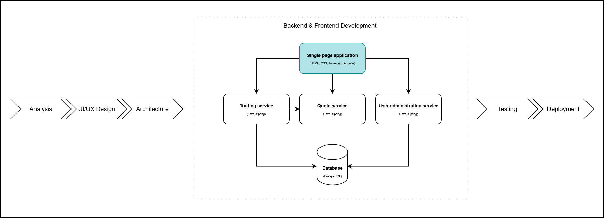

# Frontend Development: Introduction



## Table of contents

- [Components](#components)
- [Data Binding](#data-binding)
- [Signals: the basics](#signals-the-basics)
- [Control Flow](#control-flow)
- [Pipes](#pipes)
- [Directives](#directives)
- [Data Sharing](#data-sharing)
- [Routing](#routing)
- [Services and HTTP](#services-and-http)
- [Dependency Injection](#dependency-injection)
- [Route Guards](#route-guards)
- [HTTP Interceptors](#http-interceptors)
- [Reactive forms](#reactive-forms)

## About Angular - part I

- Angular is a framework for building web applications. It gives you components, templates, routing, forms and an HTTP client in one package.
- The material shows the current way of doing things. When older code you find online looks different, a short note says so.

### Components

- A component is the building block of an Angular application: a TypeScript class plus an HTML template and its CSS.
- The class holds the data and the methods; the template shows them.
- A component is marked with the **@Component** decorator:

```TypeScript
@Component({
  selector: 'app-login-page',
  imports: [ReactiveFormsModule, NgClass, RouterLink],
  templateUrl: './login-page.component.html',
  styleUrls: ['./login-page.component.css']
})
export class LoginPageComponent { }
```

- `imports` lists what the template uses: here the reactive forms directives, `[ngClass]` and `routerLink`. Each component imports what it needs itself, so nothing else has to register it.
- Use it in another template by its selector: `<app-login-page></app-login-page>`, after adding the component to that template's `imports`.
- Older Angular code groups components in **NgModules** (an `AppModule` with a `declarations` list). You will meet them in older projects; this application does not use them.

The application starts in `main.ts` with `bootstrapApplication(AppComponent, appConfig)`. `app.config.ts` holds the `providers` for the whole application: the router, the HTTP client, Toastr.

### Data Binding

- **Interpolation** shows a value in the template: `{{ username }}`.
- **Property binding** sets a property of an element: `<button [disabled]="loading()">`.
- **Event binding** runs a method when something happens: `<button (click)="login()">`.
- **Two-way binding** keeps an input and a value in sync: `<input [(ngModel)]="username">`.

### Signals: the basics

A **signal** holds a value and tells Angular when it changes, so the screen updates by itself. Signals are the recommended way to keep the state of a component.

```TypeScript
loading = signal(false);       // create, with a starting value

this.loading();                // read: call it like a function
this.loading.set(true);        // replace the value
this.count.update(c => c + 1); // compute the new value from the old one
```

- **computed** is a value calculated from other signals. You never assign it; it is always up to date:

```TypeScript
price = signal(100);
quantity = signal(1);
total = computed(() => this.price() * this.quantity());
```

- In the template, read a signal with parentheses: `{{ total() }}`. When `quantity` changes, Angular updates exactly the places that show `total()`.
- A signal compares the old and the new value with `===`. For arrays and objects, **replace** them instead of editing them: `items.update(list => [...list, item])`, not `list.push(item)`.
- In this laboratory, `loading` and `submitted` in the login and register pages are signals.

### Control Flow

The template decides what to show with `@if` and `@for` blocks:

```HTML
@if (loading()) {
  <p>Please wait...</p>
} @else {
  <button (click)="login()">Login</button>
}

@for (transaction of transactions(); track transaction.id) {
  <p>{{ transaction.username }}: {{ transaction.notional }}</p>
} @empty {
  <p>No transactions yet.</p>
}
```

- `track` is required: it tells Angular which item is which, so it only redraws the rows that changed.
- Older code uses `*ngIf` and `*ngFor` for the same thing.

### Pipes

- A pipe formats a value for display: `{{ transaction.date | date:'dd/MM/yyyy HH:mm' }}`, `{{ rate | number:'1.4-4' }}`, `{{ name | uppercase }}`.
- You can write your own with the **@Pipe** decorator and a `transform(value)` method.

### Directives

- A directive adds behaviour to an existing element. Built-in ones you will use: `[ngClass]` (add CSS classes on a condition) and `[formGroup]` (connect a form).
- You can write your own with the **@Directive** decorator, for example one that highlights the element it sits on.

### Data Sharing

- Data goes **down** from parent to child through an **input**, and events go **up** from child to parent through an **output**.

```TypeScript
// widget.component.ts (the child)
index = input.required<number>();   // the parent must pass it
deleted = output<number>();         // an event the child sends

onDelete() {
  this.deleted.emit(this.index());  // an input is a signal: read it with ()
}
```

```HTML
<!-- the parent's template -->
<app-widget [index]="i" (deleted)="onDeleteWidget($event)"></app-widget>
```

- Older code uses the `@Input()` and `@Output()` decorators for the same thing. The dashboard in [laboratory 07](../../07_Frontend_Development/Theory/README.md#inputs-and-outputs-as-functions) is built with `input()` and `output()`.

### Routing

- The router shows a different page (component) for each URL:

```TypeScript
export const routes: Routes = [
  { path: '', redirectTo: '/login', pathMatch: 'full' },
  { path: 'login', component: LoginPageComponent },
  { path: 'register', component: RegisterPageComponent },
  { path: 'dashboard', component: DashboardPageComponent, canActivate: [authGuard] },
  { path: '**', component: NotFoundPageComponent }
];
```

- The routes live in `app.routes.ts` and are given to the router in `app.config.ts` with `provideRouter(routes)`. The page appears where the template has `<router-outlet></router-outlet>`.
- `**` matches any other URL: that is the "page not found".

### Services and HTTP

- A **service** holds code that several components share, for example the calls to the backend. It is a class marked with `@Injectable({ providedIn: 'root' })`: Angular creates one instance for the whole application the first time somebody asks for it.
- `HttpClient` makes HTTP calls. It is enabled once, in `app.config.ts`, with `provideHttpClient()`.

```TypeScript
@Injectable({ providedIn: 'root' })
export class AuthenticationService {
  constructor(private http: HttpClient) { }

  login(username: string, password: string) {
    return this.http.post<User>(backendUrl.authService.authenticate, { username, password });
  }
}
```

- `http.post` returns an **Observable**: a value that arrives later. Nothing is sent until somebody subscribes, and the answer arrives once:

```TypeScript
this.authenticationService.login(username, password).subscribe({
  next: (user) => this.router.navigate(['/dashboard']),
  error: () => this.loading.set(false)
});
```

- This is the one place where you meet Observables in this laboratory. [Laboratory 07](../../07_Frontend_Development/Theory/README.md#observables) explains them and shows how to turn one into a signal.

### Dependency Injection

- A component does not create its services; it asks for them and Angular hands them over. This is **dependency injection**.
- This application asks in the constructor: `constructor(private http: HttpClient) { }`.
- The same thing can be written as a field: `private http = inject(HttpClient);`. New Angular code often uses `inject()`; both work.

### Route Guards

- A guard decides whether a route may open. Our `authGuard` lets the dashboard open only for a logged-in user:

```TypeScript
export const authGuard: CanActivateFn = (route, state) => {
  if (localStorage.getItem('currentUser')) {
    return true;
  }
  return inject(Router).createUrlTree(['/login'], { queryParams: { returnUrl: state.url } });
};
```

- A guard is a function. It returns `true` to let the route open, or a `UrlTree` to send the user somewhere else. `inject(Router)` asks Angular for the router inside the function.
- The route uses it with `canActivate: [authGuard]`.

### HTTP Interceptors

- An interceptor sees every HTTP request and response. Our application has two:
  - `jwtInterceptor` adds the user's token to every request (`Authorization: Bearer ...`);
  - `errorInterceptor` logs the user out when the server answers 401.

```TypeScript
export const jwtInterceptor: HttpInterceptorFn = (request, next) => {
  const currentUser = JSON.parse(localStorage.getItem('currentUser') || '{}');
  if (currentUser.token) {
    request = request.clone({ setHeaders: { Authorization: `Bearer ${currentUser.token}` } });
  }
  return next(request);
};
```

- An interceptor is a function: it may change the request, then passes it on with `next(request)`.
- They are registered in `app.config.ts`: `provideHttpClient(withInterceptors([jwtInterceptor, errorInterceptor]))`.

### Reactive forms

- A form blocks invalid data before it reaches the server. The login and register pages use **reactive forms**: the form is described in the component class, and the template connects to it.

```TypeScript
this.registerForm = this.formBuilder.group(
  {
    username: ['', Validators.required],
    email: ['', Validators.required],
    password: ['', [Validators.required, Validators.minLength(6)]],
    confirmPassword: ['', Validators.required],
  },
  { validator: this.mustMatch('password', 'confirmPassword') }
);
```

```HTML
<form [formGroup]="registerForm" (ngSubmit)="onSubmit()">
  <input formControlName="password" [ngClass]="{ 'is-invalid': submitted() && f['password'].errors }" />
  @if (submitted() && f['password'].errors?.['minlength']) {
    <div>Password must be at least 6 characters</div>
  }
</form>
```

- `Validators` gives the common rules (`required`, `minLength`, `email`). `mustMatch` is our own validator: it checks that the two passwords are equal. `f` is a short getter for `registerForm.controls`.
