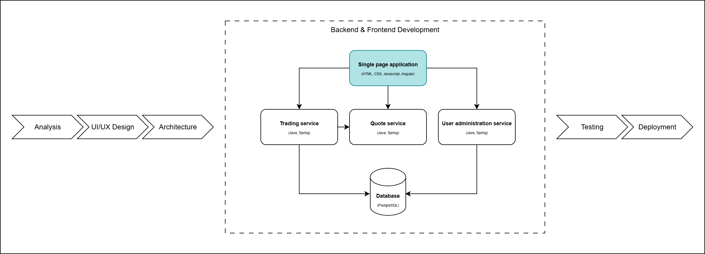

# Frontend Development: Create Dashboard Page with Angular



For this laboratory to work, it's essential to have Node.js, npm, and the Angular CLI installed on your machine. Node.js enables server-side JavaScript execution, while npm helps manage project dependencies. The Angular CLI is a command-line tool that simplifies the development of Angular applications. If you haven't installed these yet, you can download Node.js and npm from the official  [Node.js](https://nodejs.org/) website and install the [Angular CLI](https://angular.dev/installation#install-angular-cli) using npm.

**IMPORTANT**: This laboratory uses Angular 21 and Node.js 24 (`node -v` should print `v24.x.x`; the [previous laboratory](../../06_Frontend_Development/Exercise/README.md) shows how to install or update it), and Angular CLI version 21 installed globally to avoid compatibility issues with the commands used in this laboratory. You can install the CLI using:

```bash
npm install -g @angular/cli@21
```

To verify your Angular CLI version, run:

```bash
ng version
```

If you missed the previous laboratory (06_Frontend_Development), you'll also need to install [Git](https://git-scm.com/) and clone the project repository using the command below, or download it directly from GitHub:

```bash
git clone https://github.com/webtoknow/fx-trading-app.git
```

> To run the supplied solution or switch between mocks and Java services, see [Local frontend setup](../../FRONTEND_LABS.md).

## Before you start

Continue in your own 06 project if it builds and you can log in with it. Everything below is written for that project (the paths say `Exercise/Code/ui`; use your own folder).

Otherwise start from `07_Frontend_Development/Exercise/Code`: the UI and the mock server, ready to run, so the paths in this laboratory work as written.

The dashboard uses the two kinds of reactivity from the [Theory](../Theory/README.md):

- **Observables** for things that happen over time: HTTP calls and the 2-second polling.
- **Signals** for state and derived state: the filters, the widgets, the rates on screen.
- `toSignal` and `toObservable` to move between the two.

## Table of contents
- [Before you start](#before-you-start)
- [Exercise 0 - Configure and start Mock Server](#exercise-0---configure-and-start-mock-server)
- [Exercise 1 - Create blotter-view, fx-rates-view and widget components](#exercise-1---create-blotter-view-fx-rates-view-and-widget-components)
- [Exercise 2 - Blotter View page](#exercise-2---blotter-view-page)
  - [Transaction model](#transaction-model)
  - [Trade service and the polling mechanism](#trade-service-and-the-polling-mechanism)
  - [Blotter View component](#blotter-view-component)
- [Exercise 3 - FX Rates View page](#exercise-3---fx-rates-view-page)
  - [Rate model](#rate-model)
  - [Widget model](#widget-model)
  - [Update Trade service](#update-trade-service)
  - [Widget component](#widget-component)
  - [FX Rates View component](#fx-rates-view-component)
  - [Check the application config](#check-the-application-config)
- [Done when](#done-when)

## Exercise 0 - Configure and start Mock Server

Mock server is used to create a fake API to mock the backend data using [JSON Server](https://github.com/typicode/json-server).

**Note**: Choose either the mocks or the real Java services. Both use the same proxy and ports 8200–8220; stop one before starting the other. A configured proxy can connect to either mode. The mock login is `student` / `student123`, or register a new user. Accounts are separate from the Java backend.

Let's install its packages:

```bash
cd fx-trading-app/07_Frontend_Development/Exercise/Code/mock-server
npm install
```

Start all microservices in a single terminal:

```bash
npm start
```

Now we can access these APIs:

- `http://localhost:8200/user/authenticate` - sign-in
- `http://localhost:8200/user/register` - register
- `http://localhost:8210/transactions` - get all transactions
- `http://localhost:8220/currencies` - get all currencies
- `http://localhost:8220/fx-rate` - get fx rates for specific currencies

**Remember**: For both mocks and Java services, ensure your **ui/src/app/constants.ts** file uses the proxy paths configured in the previous session (`/auth`, `/trade`, `/quote`) and that your **package.json** start script includes `--proxy-config proxy.conf.json`.

## Exercise 1 - Create blotter-view, fx-rates-view and widget components

Go to *07_Frontend_Development/Exercise/Code/ui* using a new **terminal** window:

```bash
cd fx-trading-app/07_Frontend_Development/Exercise/Code/ui
```

Run `npm install` to download all dependencies:

```bash
npm install
```
Start dev server:

```bash
npm run start
```

Leave it running and open a second terminal for the commands below (or stop it with `Ctrl+C` and start it again later).

By taking a look at the design mockup, we can see that it can be divided in 2 big sections: **FX Rates View** and **Blotter View**. Also, the first one contains many widgets looking the same, so this can be also splitted into **Widget** components.

So, *dashboard-page* component will use 3 smaller components:

- *blotter-view*
- *fx-rates-view*
- *widget*

Let's create them!

First, go to *07_Frontend_Development/Exercise/Code/ui/src/app/pages/dashboard-page* and use Angular CLI to create these 3 new components, children of *dashboard-page* components:

```bash
cd fx-trading-app/07_Frontend_Development/Exercise/Code/ui/src/app/pages/dashboard-page

ng generate component blotter-view
ng generate component fx-rates-view
ng generate component widget
```

Each command creates a standalone component, so nothing else has to register it: the component that uses another one lists it in its own `imports`. Each command also creates a `*.spec.ts` file (a unit test) next to the component. Replace each generated test with the one in the `<details>` block below. Paste the tests as you go, but run them at the end: the trade-service tests include methods added in Exercise 3.

In the design, the top section features a navbar that includes the logo and a Logout button. We'll now incorporate this into the `dashboard-page` component along with the `blotter-view` and `fx-rates-view` components. To structure the layout, we'll utilize Bootstrap for styling and positioning.

So, in *dashboard-page.component.html*, we will have:

```HTML
<!-- Navigation -->
<header>
  <nav class="navbar">
    
    <button type="button" class="btn btn-logout" (click)="logout()">Log out</button>
  </nav>
</header>

<!-- Main -->
<main class="dashboard-container">
  <div class="row">
    <div class="col-sm">
      <app-fx-rates-view></app-fx-rates-view>
    </div>
    <div class="col-sm">
      <app-blotter-view></app-blotter-view>
    </div>
  </div>
</main>
```

and in *dashboard-page.component.css*:

```CSS
.dashboard-container {
  padding: 2rem 3rem;
}

.navbar {
  padding: 0.5rem 3rem;
  border: 1px solid #dddddd;
}

.fx-main-logo {
  width: 70px;
  height: 50px;
}

.btn-logout {
  border: 1px solid #dddddd;
  color: #7c7c7c;
}

.btn-logout:hover {
  background-color: #f2f2f2;
  opacity: 0.8;
}
```

The *Log out* button calls a `logout()` method, so in *dashboard-page.component.ts* inject the authentication service and the router and add it:

```TypeScript
import { Component } from '@angular/core';
import { Router } from '@angular/router';
import { AuthenticationService } from '../../services/authentication.service';
import { BlotterViewComponent } from './blotter-view/blotter-view.component';
import { FxRatesViewComponent } from './fx-rates-view/fx-rates-view.component';

@Component({
  selector: 'app-dashboard-page',
  imports: [BlotterViewComponent, FxRatesViewComponent],
  templateUrl: './dashboard-page.component.html',
  styleUrl: './dashboard-page.component.css'
})
export class DashboardPageComponent {
  constructor(
    private authenticationService: AuthenticationService,
    private router: Router
  ) {}

  logout() {
    this.authenticationService.logout();
    this.router.navigate(['/login']);
  }
}
```

## Exercise 2 - Blotter View page

### Transaction model

Into *07_Frontend_Development/Exercise/Code/ui/src/app/models*, let's make a new file, named `transaction.ts`,representing the *Transaction* model:

```JavaScript
export interface Transaction {
    id?: number;
    username: string;
    primaryCcy: string
    secondaryCcy: string;
    rate: number;
    action: string;
    notional: number | null;
    tenor: string;
    date: number;
    ccyPair?: string
}
```

### Trade service and the polling mechanism

In *07_Frontend_Development/Exercise/Code/ui/src/app/services*, let's create a file, *trade.service.ts*, which will contain all API calls desired to get data from JSON Server.

```bash
cd fx-trading-app/07_Frontend_Development/Exercise/Code/ui/src/app/services
ng generate service trade
```

The service needs its own test. Replace the content of the generated `trade.service.spec.ts`:

<details>
<summary>trade.service.spec.ts</summary>

```TypeScript
import { fakeAsync, TestBed, tick } from '@angular/core/testing';
import { provideHttpClient } from '@angular/common/http';
import { HttpTestingController, provideHttpClientTesting } from '@angular/common/http/testing';
import { backendUrl } from '../constants';
import { Rate } from '../models/rate';

import { TradeService } from './trade.service';

describe('TradeService', () => {
  let service: TradeService;
  let http: HttpTestingController;

  beforeEach(() => {
    TestBed.configureTestingModule({ providers: [provideHttpClient(), provideHttpClientTesting()] });
    service = TestBed.inject(TradeService);
    http = TestBed.inject(HttpTestingController);
  });

  afterEach(() => http.verify());

  it('should be created', () => {
    expect(service).toBeTruthy();
  });

  it('keeps polling transactions after a temporary failure and stops on unsubscribe', fakeAsync(() => {
    const received: unknown[] = [];
    const subscription = service.getTransactionsPolling().subscribe(rows => received.push(rows));
    http.expectOne(backendUrl.fxTradeService.getTransactions).flush([], { status: 503, statusText: 'Unavailable' });
    tick(2000);
    http.expectOne(backendUrl.fxTradeService.getTransactions).flush([]);
    expect(received).toEqual([[]]);
    subscription.unsubscribe();
    tick(2000);
    http.expectNone(backendUrl.fxTradeService.getTransactions);
  }));

  it('clears failed quotes and recovers on the next poll with the same pair', fakeAsync(() => {
    const received: (Rate | null)[] = [];
    const subscription = service.getFxRatePolling('EUR', 'USD').subscribe(rate => received.push(rate));
    const request = () => http.expectOne(r => r.url === backendUrl.quoteService.getFxRate &&
      r.params.get('primaryCcy') === 'EUR' && r.params.get('secondaryCcy') === 'USD');
    const rate = { buyRate: 1.2, sellRate: 1.1, ts: '2026-11-10T00:00:00Z' };
    request().flush(rate);
    tick(2000);
    request().flush(null, { status: 503, statusText: 'Unavailable' });
    tick(2000);
    request().flush(rate);
    expect(received).toEqual([rate, null, rate]);
    subscription.unsubscribe();
  }));

  it('retries the currency list when the quote service starts late', fakeAsync(() => {
    const received: string[][] = [];
    service.getCurrencies().subscribe(currencies => received.push(currencies));
    http.expectOne(backendUrl.quoteService.getCurrencies).error(new ProgressEvent('error'));
    tick(2000);
    http.expectOne(backendUrl.quoteService.getCurrencies).flush(['EUR', 'USD']);
    expect(received).toEqual([['EUR', 'USD']]);
  }));
});
```

</details>

Our first method will retrieve the transactions to be displayed in the table on the right side of the page. To simulate real-time updates, we use a **polling mechanism**: the transactions are fetched again every 2 seconds, creating a real-time experience. Replace the content of `trade.service.ts` with:

```TypeScript
import { Injectable } from '@angular/core';
import { backendUrl } from '../constants';
import { HttpClient } from '@angular/common/http';
import { catchError, EMPTY, interval, startWith, switchMap } from 'rxjs';
import { Transaction } from '../models/transaction';

@Injectable({
  providedIn: 'root',
})
export class TradeService {
  constructor(private http: HttpClient) {}

  getTransactionsPolling() {
    return interval(2000).pipe(
      startWith(0),
      switchMap(() => this.http.get<Transaction[]>(backendUrl.fxTradeService.getTransactions).pipe(
        catchError(() => EMPTY)
      ))
    );
  }
}
```

Explanation:
- `interval(2000)`: Creates an observable that emits a value every 2 seconds.
- `startWith(0)`: Ensures the polling starts immediately without waiting for the first 2-second interval.
- `switchMap()`: Maps each emitted value to the HTTP request to fetch transactions. It ensures that only the latest HTTP request is handled while canceling the previous one if still pending.
- The result is an `Observable<Transaction[]>` that never completes: it delivers a new list every 2 seconds, until somebody unsubscribes.

This is exactly what an **Observable** is for: a thing that *happens over time*. The service returns the Observable and does not subscribe to it; the component decides when to start listening. (There is no `getTransactions()` for a single call: the dashboard only needs the polling version.)

### Blotter View component

We'll use the Blotter View component to present the transaction data in a table format. This component will also include filtering options, allowing users to filter transactions by currency pair and date:

**blotter-view.component.html**:

```HTML
<div class="title title-border">
  <h4>Blotter View</h4>
</div>
<div class="filter-container">
  <span class="flex-vertical-centered filter-label">Filters</span>
  <span class="flex-vertical-centered filter-separator">|</span>
  <div class="filter-input-container">
    <div class="flex-vertical-centered filter-group">
      <span>Ccy&nbsp;Pair&nbsp;&nbsp;</span>
      <select
        name="Ccy"
        id="Ccy"
        class="form-control form-control-sm"
        [ngModel]="ccyPair()"
        (ngModelChange)="ccyPair.set($event)"
        >
        <option value="" selected>Please select&nbsp;&nbsp;</option>
        @for (currencyPair of pairs(); track currencyPair) {
          <option
            [value]="currencyPair"
            >
            {{ currencyPair }}
          </option>
        }
      </select>
    </div>

    <div class="flex-vertical-centered filter-group">
      <span for="dateFilter">Date&nbsp;&nbsp;</span>
      <div class="input-group input-group-sm">
        <input
          type="text"
          class="form-control form-control-sm"
          placeholder="Please select&nbsp;"
          [ngModel]="date()"
          (ngModelChange)="date.set($event ?? null)"
          [bsConfig]="{ dateInputFormat: 'DD/MM/YYYY' }"
          #dp="bsDatepicker"
          bsDatepicker
          />
        <div class="input-group-append">
          <button
            class="input-group-text calendar-icon"
            id="date-picker-icon"
            (click)="dp.show()"
            [attr.aria-expanded]="dp.isOpen"
            >
            <i class="fa fa-calendar-check-o icon" aria-hidden="true"></i>
          </button>
        </div>
      </div>
    </div>
  </div>
</div>

<div class="table-responsive">
  <table class="table table-striped table-sm">
    <thead class="blotter-table-header">
      <tr>
        <th>ID</th>
        <th>
          <span>Username&nbsp;</span>
        </th>
        <th>
          <span>Ccy Pair&nbsp;</span>
        </th>
        <th>Rate</th>
        <th>
          <span>Action&nbsp;</span>
        </th>
        <th>
          <span>Notional&nbsp;</span>
        </th>
        <th>Tenor</th>
        <th>
          <span>Transaction Date&nbsp;</span>
        </th>
      </tr>
    </thead>
    <tbody>
      @for (transaction of rows(); track transaction.id) {
        <tr>
          <td>{{ transaction.id }}</td>
          <td>{{ transaction.username }}</td>
          <td>{{ transaction.ccyPair }}</td>
          <td>{{ transaction.rate | number }}</td>
          <td>{{ transaction.action }}</td>
          <td>{{ transaction.notional | number }}</td>
          <td>{{ transaction.tenor }}</td>
          <td>{{ transaction.date | date : "dd/MM/yyyy HH:mm" }}</td>
        </tr>
      }
    </tbody>
  </table>
</div>
```

This template includes:
- A filter section for selecting Currency Pair and Date.
- A table to display transaction data: ID, Username, Currency Pair, Rate, Action, Notional, Tenor, and Transaction Date.

Two things in the template are new compared to the register and login pages:

- Everything is read with parentheses: `pairs()`, `rows()`, `ccyPair()`, `date()`. They are signals, defined in the TypeScript file below.
- The filters use `[ngModel]="ccyPair()"` together with `(ngModelChange)="ccyPair.set($event)"`. Read it as two separate one-way flows: the box *shows* what the signal holds (`[ngModel]`, data goes down), and when the user picks something, the new value is *put into* the signal (`(ngModelChange)`, the event goes up). Angular can also bind a signal in the two-way form `[(ngModel)]="ccyPair"`; here we write the two directions out so you can see what happens, and you will meet the same pair of bindings in the widget.

**blotter-view.component.css**:

```CSS
.filter-container {
  margin-bottom: 22px;
  display: flex;
}

.filter-label {
  text-transform: uppercase;
  font-weight: bold;
}

.filter-separator {
  color: rgb(221, 221, 221);
  margin-left: 10px;
  margin-right: 10px;
}

.filter-input-container {
  display: flex;
  align-items: center;
  justify-content: flex-start;
  flex: 1;
}

.filter-group {
  margin-right: 15px;
}

.calendar-icon {
  background-color: white;
  color: #7c7c7c;
}

.calendar-icon:focus {
  outline: 0;
}

.calendar-icon > i {
  font-size: 18px;
}

.blotter-table-header {
  background: #3496f0;
  color: white;
  overflow: hidden;
  white-space: nowrap;
}

.blotter-table-header th {
  padding-bottom: 6px;
  padding-top: 6px;
}
```

**blotter-view.component.ts**:

```TypeScript
import {
  ChangeDetectionStrategy,
  Component,
  computed,
  inject,
  signal,
} from '@angular/core';
import { toSignal } from '@angular/core/rxjs-interop';
import { Transaction } from '../../../models/transaction';
import { TradeService } from '../../../services/trade.service';
import { DatePipe, DecimalPipe } from '@angular/common';
import { FormsModule } from '@angular/forms';
import { BsDatepickerModule } from 'ngx-bootstrap/datepicker';

@Component({
  selector: 'app-blotter-view',
  imports: [FormsModule, BsDatepickerModule, DatePipe, DecimalPipe],
  templateUrl: './blotter-view.component.html',
  styleUrl: './blotter-view.component.css',
  changeDetection: ChangeDetectionStrategy.OnPush,
})
export class BlotterViewComponent {
  private tradeService = inject(TradeService);

  transactions = toSignal(this.tradeService.getTransactionsPolling(), {
    initialValue: [] as Transaction[],
  });

  // Filter state
  ccyPair = signal('');
  date = signal<Date | null>(null);

  private withCcyPair = computed<Transaction[]>(() =>
    this.transactions().map((transaction) => ({
      ...transaction,
      ccyPair: `${transaction.primaryCcy}/${transaction.secondaryCcy}`,
    }))
  );

  pairs = computed(() => [
    ...new Set(this.withCcyPair().map((transaction) => transaction.ccyPair)),
  ]);

  rows = computed(() => {
    const ccyPair = this.ccyPair();
    const date = this.date();
    return this.withCcyPair().filter(
      (transaction) =>
        (!ccyPair || transaction.ccyPair === ccyPair) &&
        (!date || this.isSameDay(transaction.date, date))
    );
  });

  // same day = same year, month and getDate() (not getDay())
  private isSameDay(a: number | Date, b: number | Date): boolean {
    const first = new Date(a);
    const second = new Date(b);
    return (
      first.getFullYear() === second.getFullYear() &&
      first.getMonth() === second.getMonth() &&
      first.getDate() === second.getDate()
    );
  }
}
```

What the code does:

- **From Observable to signal: `toSignal`.** `getTransactionsPolling()` is an Observable. The template wants "the transactions right now", which is a signal. `toSignal(...)` subscribes to the Observable and writes every new list into a signal. It also **unsubscribes by itself when the component is destroyed**, so there is no `ngOnDestroy` and no `Subscription` field to remember. `initialValue: []` is what the signal holds until the first answer arrives; without it the type would be `Transaction[] | undefined`.
- **State is a signal.** `ccyPair` and `date` are the filters: values that the user changes, so they are signals. `date` is `Date | null` because the datepicker can be cleared.
- **Derived state is `computed`.** `withCcyPair`, `pairs` and `rows` are never assigned by any method. Each one is a rule written once: "the transactions with a `ccyPair` label", "the distinct labels", "the labels that pass both filters". When the poll brings a new list, or the user changes a filter, Angular recalculates only what depends on it.
- **`isSameDay`** compares year, month and *day of the month* (`getDate()`). An earlier version of this code used `getDay()`, which is the day of the *week* (0 to 6), where the day of the *month* was needed, so the filter matched the wrong days.
- **`changeDetection: ChangeDetectionStrategy.OnPush`.** Normally Angular re-checks every component after every event in the whole app. `OnPush` says: check this component only when an input changed, when an event happened in it, or when a **signal its template reads** changed. The table still updates every 2 seconds because the poll writes into the `transactions` signal, `rows()` depends on it, and the template reads `rows()`. (If you kept the data in a plain field and changed it inside a `subscribe`, an `OnPush` component would not update.)

The blotter spec fills the table with fake transactions and checks the filters, including the day-of-the-month case. Replace the content of the generated `blotter-view.component.spec.ts`:

<details>
<summary>blotter-view.component.spec.ts</summary>

```TypeScript
import { provideHttpClient } from '@angular/common/http';
import {
  HttpTestingController,
  provideHttpClientTesting,
} from '@angular/common/http/testing';
import { NO_ERRORS_SCHEMA } from '@angular/core';
import { ComponentFixture, TestBed } from '@angular/core/testing';
import { FormsModule } from '@angular/forms';
import { BsDatepickerModule } from 'ngx-bootstrap/datepicker';
import { backendUrl } from '../../../constants';
import { Transaction } from '../../../models/transaction';

import { BlotterViewComponent } from './blotter-view.component';

function transaction(
  id: number,
  primaryCcy: string,
  secondaryCcy: string,
  date: Date
): Transaction {
  return {
    id,
    username: 'ana',
    primaryCcy,
    secondaryCcy,
    rate: 1.1,
    action: 'BUY',
    notional: 1000,
    tenor: 'SP',
    date: date.getTime(),
  };
}

describe('BlotterViewComponent', () => {
  let component: BlotterViewComponent;
  let fixture: ComponentFixture<BlotterViewComponent>;
  let http: HttpTestingController;

  // 5 March 23:59 and 6 March 00:01 are two minutes apart but on different days.
  // 13 March is the same weekday as 6 March (the old getDay() comparison matched them).
  const data = [
    transaction(1, 'EUR', 'USD', new Date(2026, 2, 5, 23, 59)),
    transaction(2, 'EUR', 'USD', new Date(2026, 2, 6, 0, 1)),
    transaction(3, 'GBP', 'RON', new Date(2026, 2, 6, 12, 0)),
    transaction(4, 'EUR', 'USD', new Date(2026, 2, 13, 12, 0)),
  ];

  const ids = () => component.rows().map((row) => row.id);

  beforeEach(async () => {
    await TestBed.configureTestingModule({
      imports: [BlotterViewComponent, FormsModule, BsDatepickerModule],
      providers: [provideHttpClient(), provideHttpClientTesting()],
      schemas: [NO_ERRORS_SCHEMA],
    }).compileComponents();

    http = TestBed.inject(HttpTestingController);
    fixture = TestBed.createComponent(BlotterViewComponent);
    component = fixture.componentInstance;
    fixture.detectChanges();
    http
      .expectOne((r) => r.url === backendUrl.fxTradeService.getTransactions)
      .flush(data);
  });

  it('should create', () => {
    expect(component).toBeTruthy();
  });

  it('shows every transaction and the distinct pairs when no filter is set', () => {
    expect(ids()).toEqual([1, 2, 3, 4]);
    expect(component.pairs()).toEqual(['EUR/USD', 'GBP/RON']);
  });

  it('filters by currency pair', () => {
    component.ccyPair.set('GBP/RON');
    expect(ids()).toEqual([3]);

    component.ccyPair.set('EUR/USD');
    expect(ids()).toEqual([1, 2, 4]);

    component.ccyPair.set('');
    expect(ids()).toEqual([1, 2, 3, 4]);
  });

  it('filters by day of the month: 23:59 and 00:01 the next day are different days', () => {
    component.date.set(new Date(2026, 2, 5, 8, 0));
    expect(ids()).toEqual([1]);

    component.date.set(new Date(2026, 2, 6, 17, 30));
    expect(ids()).toEqual([2, 3]);
  });

  it('does not match another date that has the same weekday', () => {
    component.date.set(new Date(2026, 2, 6));
    expect(ids()).not.toContain(4);
  });

  it('combines the pair and the date filter', () => {
    component.date.set(new Date(2026, 2, 6));
    component.ccyPair.set('EUR/USD');
    expect(ids()).toEqual([2]);
  });

  it('renders the filtered rows', () => {
    component.ccyPair.set('GBP/RON');
    fixture.detectChanges();
    expect(fixture.nativeElement.querySelectorAll('tbody tr').length).toBe(1);
  });
});
```

</details>

## Exercise 3 - FX Rates View page

### Rate model

In the folder *07_Frontend_Development/Exercise/Code/ui/src/app/models*, create a new file named `rate.ts`. This file will define the Rate model:

```JavaScript
export interface Rate {
    buyRate: number;
    sellRate: number;
    ts?: string | number;
}
```

### Widget model

In the same folder, *07_Frontend_Development/Exercise/Code/ui/src/app/models*, add a new file named `widget.ts` to define the **Widget** class and **RateTrend** enum:

```JavaScript
export class Widget {
  constructor(
    public primaryCcy: string = '',
    public secondaryCcy: string = '',
    public buyRate: number = 0,
    public sellRate: number = 0,
    public notional: number | null = null,
    public tenor: string = '',
    public pickCCYState: boolean = true
  ) {}
}

export enum RateTrend {
  UP = 'up',
  DOWN = 'down',
  FLAT = 'flat',
}
```

### Update Trade service

We will add three more methods to `trade.service.ts`:

- `saveTransaction` for saving the transaction when the user clicks the *Sell* or *Buy* buttons;
- `getCurrencies` for the currencies the user can pick from (one HTTP call, one answer);
- `getFxRatePolling` to simulate real-time updates of the FX rates of one pair: the same `interval` + `startWith` + `switchMap` recipe as before, with the two currencies sent as query parameters.

Catch polling errors inside `switchMap`, so a failed request does not stop later polls. Failed rates emit `null` to clear the quote; failed transaction reads keep the previous rows. Currency loading retries every 2 seconds if the quote service starts late.

The whole file now looks like this:

```TypeScript
import { Injectable } from '@angular/core';
import { backendUrl } from '../constants';
import { HttpClient } from '@angular/common/http';
import { catchError, EMPTY, interval, Observable, of, retry, startWith, switchMap } from 'rxjs';
import { Transaction } from '../models/transaction';
import { Rate } from '../models/rate';

@Injectable({
  providedIn: 'root',
})
export class TradeService {
  constructor(private http: HttpClient) {}

  getTransactionsPolling() {
    return interval(2000).pipe(
      startWith(0),
      switchMap(() => this.http.get<Transaction[]>(backendUrl.fxTradeService.getTransactions).pipe(
        catchError(() => EMPTY)
      ))
    );
  }

  saveTransaction(transaction: Transaction) {
    return this.http.post(
      backendUrl.fxTradeService.saveTransaction,
      transaction
    ) as Observable<any>;
  }

  getCurrencies() {
    return this.http.get<string[]>(backendUrl.quoteService.getCurrencies).pipe(
      retry({ delay: 2000 })
    );
  }

  getFxRatePolling(primaryCcy: string, secondaryCcy: string) {
    return interval(2000).pipe(
      startWith(0),
      switchMap(() =>
        this.http.get<Rate>(backendUrl.quoteService.getFxRate, {
          params: { primaryCcy, secondaryCcy },
        }).pipe(
          catchError(() => of(null))
        )
      )
    );
  }
}
```

All four methods return Observables and none of them subscribes. Who listens, and when, is decided by the components.

### Widget component

The widget is the most important component of the dashboard, and the place where the two kinds of reactivity meet. Read the code first, then the explanation below it.

**widget.component.html**:

```HTML
<div class="content-widget">
  <!-- Close -->
  <div (click)="onDelete()">
    <span class="fa fa-times close"></span>
  </div>

  <!-- Select currency step -->
  @if (pickCCYState()) {
    <div>
      <h4 class="widget-title">Pick a currency</h4>
      <div class="content-container">
        <div class="mb-3 row">
          <label class="col-sm-3 col-form-label" for="primaryCcy">Primary</label>
          <div class="col-sm-9">
            <select
              name="primaryCcy"
              id="primaryCcy"
              class="form-control"
              [ngModel]="primaryCcy()"
              (ngModelChange)="primaryCcy.set($event)"
              required
              >
              <option value="" disabled selected>Please select</option>
              @for (currency of currencies(); track currency) {
                <option [value]="currency">
                  {{ currency }}
                </option>
              }
            </select>
          </div>
        </div>
        <div class="mb-3 row">
          <label class="col-sm-3 col-form-label" for="secondaryCcy"
            >Secondary</label
            >
            <div class="col-sm-9">
              <select
                name="secondaryCcy"
                id="secondaryCcy"
                class="form-control"
                [ngModel]="secondaryCcy()"
                (ngModelChange)="secondaryCcy.set($event)"
                required
                >
                <option value="" disabled selected>Please select</option>
                @for (currency of currencies(); track currency) {
                  <option [value]="currency">
                    {{ currency }}
                  </option>
                }
              </select>
            </div>
          </div>
          <div class="btn-wraper">
            <button class="btn btn-primary" (click)="onPickCurrency()">Ok</button>
          </div>
        </div>
      </div>
    }

    <!-- Trade step -->
    @if (!pickCCYState()) {
      <div>
        <!-- Title -->
        <h4 class="widget-title no-border">
          <span class="widget-primary">{{ primaryCcy() }}</span
            >/{{ secondaryCcy() }}
            <span class="fa fa-exchange exchange" (click)="onCCYChange()"></span>
          </h4>
          <!-- Rates -->
          <div class="rates-container">
            <div>
              <span class="widget-subtitle">SELL: </span>
              <span class="rate">{{ rates()?.sellRate | number : "1.1-2" }}</span>
              @if (sellTrend() === RateTrend.UP) {
                <i class="fa fa-chevron-up rate-up"></i>
              }
              @if (sellTrend() === RateTrend.DOWN) {
                <i class="fa fa-chevron-down rate-down"></i>
              }
              @if (sellTrend() === RateTrend.FLAT) {
                <i class="fa fa-minus rate-flat"></i>
              }
            </div>
            <div>
              <span class="widget-subtitle">BUY: </span>
              <span class="rate">{{ rates()?.buyRate | number : "1.1-2" }}</span>
              @if (buyTrend() === RateTrend.UP) {
                <i class="fa fa-chevron-up rate-up"></i>
              }
              @if (buyTrend() === RateTrend.DOWN) {
                <i class="fa fa-chevron-down rate-down"></i>
              }
              @if (buyTrend() === RateTrend.FLAT) {
                <i class="fa fa-minus rate-flat"></i>
              }
            </div>
          </div>
          <div class="content-container">
            <!-- Form  -->
            <div class="mb-3 row">
              <label class="col-sm-3 col-form-label" for="amount">Amount</label>
              <div class="col-sm-9">
                <input
                  type="number"
                  class="form-control"
                  id="amount"
                  placeholder="Type the amount"
                  [ngModel]="notional()"
                  (ngModelChange)="notional.set($event)"
                  required
                  />
              </div>
            </div>
            <div class="mb-3 row">
              <label class="col-sm-3 col-form-label" for="tenor">Tenor</label>
              <div class="col-sm-9">
                <select
                  name="tenor"
                  id="tenor"
                  class="form-control"
                  [ngModel]="tenor()"
                  (ngModelChange)="tenor.set($event)"
                  required
                  >
                  <option value="" disabled selected>Please select</option>
                  @for (tenor of tenors; track tenor) {
                    <option [value]="tenor">
                      {{ tenor }}
                    </option>
                  }
                </select>
              </div>
            </div>
            <!-- Buttons  -->
            <div class="btns-wrapper">
              <button class="btn btn-primary" (click)="onSell()">Sell</button>
              <button class="btn btn-success" (click)="onBuy()">Buy</button>
            </div>
          </div>
        </div>
      }
    </div>
```

**widget.component.css**:

```CSS
.content-widget {
  width: 100%;
  position: relative;
}

.widget-title {
  padding: 1rem 1rem 10px;
  border-bottom: 1px solid #dddddd;
  margin: 0;
  font-size: 20px;
  font-weight: bold;
}

.widget-subtitle {
  font-size: 20px;
  color: #7c7c7c;
  font-weight: bold;
}

.widget-primary {
  font-size: 24px;
  color: #373a3c;
}

.widget-primary-currency {
  color: #373a3c;
  font-size: 24px;
}

.form-control {
  display: flex;
  flex-grow: 1;
}

.btn-wraper {
  display: grid;
  justify-content: flex-end;
}

.btns-wrapper {
  display: flex;
  justify-content: space-between;
}

.rates-container {
  display: flex;
  justify-content: space-between;
  background: #f2f2f2;
  padding: 10px 1rem;
}

.rate-up {
  color: green;
}

.rate-down {
  color: red;
}

.rate-flat {
  color: #373a3c;
}

.rate {
  font-size: 30px;
  font-weight: bold;
}

.content-container {
  padding: 1rem;
}

.close {
  position: absolute;
  top: 1rem;
  right: 1rem;
  font-size: 15px;
}

.no-border {
  border: 0;
}

.exchange {
  color: #f0ad4e;
  font-size: 18px;
  cursor: pointer;
}

@media only screen and (max-width: 1440px) {
  .rate {
    font-size: 26px;
  }
}
```

**widget.component.ts**:

```TypeScript
import {
  ChangeDetectionStrategy,
  Component,
  computed,
  inject,
  input,
  linkedSignal,
  output,
} from '@angular/core';
import { toObservable, toSignal } from '@angular/core/rxjs-interop';
import { EMPTY, of } from 'rxjs';
import { catchError, startWith, switchMap } from 'rxjs/operators';
import { ToastrService } from 'ngx-toastr';
import { TradeService } from '../../../services/trade.service';
import { RateTrend, Widget } from '../../../models/widget';
import { Rate } from '../../../models/rate';
import { DecimalPipe } from '@angular/common';
import { FormsModule } from '@angular/forms';

function trendOf(previous?: number, current?: number): RateTrend {
  if (previous === undefined || current === undefined) {
    return RateTrend.FLAT;
  }
  return current > previous
    ? RateTrend.UP
    : current < previous
    ? RateTrend.DOWN
    : RateTrend.FLAT;
}

@Component({
  selector: 'app-widget',
  imports: [FormsModule, DecimalPipe],
  templateUrl: './widget.component.html',
  styleUrls: ['./widget.component.css'],
  changeDetection: ChangeDetectionStrategy.OnPush,
})
export class WidgetComponent {
  private tradeService = inject(TradeService);
  private toastr = inject(ToastrService);

  tenors = ['SP', '1M', '3M'];
  RateTrend = RateTrend;

  // Inputs and output
  widget = input.required<Widget>();
  index = input.required<number>();
  currencies = input<string[]>([]);
  deleted = output<number>();

  pickCCYState = linkedSignal(() => this.widget().pickCCYState);
  primaryCcy = linkedSignal(() => this.widget().primaryCcy);
  secondaryCcy = linkedSignal(() => this.widget().secondaryCcy);
  notional = linkedSignal(() => this.widget().notional);
  tenor = linkedSignal(() => this.widget().tenor);

  pair = computed(() => {
    const primary = this.primaryCcy();
    const secondary = this.secondaryCcy();
    if (this.pickCCYState() || !primary || !secondary || primary === secondary) {
      return null;
    }
    return { primary, secondary };
  });

  rates = toSignal(
    toObservable(this.pair).pipe(
      switchMap((pair) =>
        pair
          ? this.tradeService
              .getFxRatePolling(pair.primary, pair.secondary)
              .pipe(
                startWith(null),
                catchError(() => {
                  this.toastr.error('Could not load the rates!');
                  return EMPTY;
                })
              )
          : of(null)
      )
    )
  );

  buyTrend = linkedSignal<Rate | null | undefined, RateTrend>({
    source: this.rates,
    computation: (rate, previous) =>
      trendOf(previous?.source?.buyRate, rate?.buyRate),
  });
  sellTrend = linkedSignal<Rate | null | undefined, RateTrend>({
    source: this.rates,
    computation: (rate, previous) =>
      trendOf(previous?.source?.sellRate, rate?.sellRate),
  });

  canTrade = computed(() => {
    const amount = this.notional();
    return amount !== null && Number.isFinite(amount) && amount > 0 && this.tenors.includes(this.tenor());
  });

  onDelete() {
    this.deleted.emit(this.index());
  }

  onSell() {
    this.trade('SELL', (rate) => rate.sellRate);
  }

  onBuy() {
    this.trade('BUY', (rate) => rate.buyRate);
  }

  private trade(action: 'BUY' | 'SELL', pick: (rate: Rate) => number) {
    const pair = this.pair();
    const rate = this.rates();
    if (!this.canTrade()) {
      this.toastr.error('Please enter a positive Amount and select a Tenor!');
      return;
    }
    if (!pair || !rate) {
      this.toastr.error('No rate available yet!');
      return;
    }
    this.tradeService
      .saveTransaction({
        username: this.currentUsername(),
        primaryCcy: pair.primary,
        secondaryCcy: pair.secondary,
        rate: pick(rate),
        action,
        notional: this.notional(),
        tenor: this.tenor(),
        date: Date.now(),
      })
      .subscribe({
        next: () => this.toastr.success('Transaction saved!'),
        error: () => this.toastr.error('Transaction could not be saved!'),
      });
  }

  private currentUsername(): string {
    try {
      return JSON.parse(localStorage.getItem('currentUser') ?? 'null')?.username ?? '';
    } catch {
      return '';
    }
  }

  onCCYChange() {
    this.switchCCY();
  }

  switchCCY() {
    const previousPrimary = this.primaryCcy();
    this.primaryCcy.set(this.secondaryCcy());
    this.secondaryCcy.set(previousPrimary);
  }

  onPickCurrency() {
    const primary = this.primaryCcy();
    const secondary = this.secondaryCcy();
    if (primary && secondary && primary !== secondary) {
      this.pickCCYState.set(false);
    } else if (!primary || !secondary) {
      this.toastr.error('Please select both Primary and Secondary Currencies!');
    } else {
      this.toastr.error(
        'Please select different Primary and Secondary Currencies!'
      );
    }
  }
}
```

Here are some key points to note:
- A widget can be removed by clicking the close icon located at the top-right corner.
- There are two main steps involved:
  - First, users can add a new currency pair, allowing them to monitor *BUY* and *SELL* rates. This step includes selecting Primary and Secondary currencies from two dropdowns, which are populated by the currencies that the parent gives to the widget (they come from `getCurrencies()` in trade.service.ts).
  - Second, users can save a transaction by entering the trade amount and selecting a tenor (SP for immediate, 1M for one month, or 3M for three months). They can then choose to execute a *Sell* or *Buy* action by pressing the respective button.

Now the code, piece by piece.

**1. Inputs and an output as functions.**

```TypeScript
widget = input.required<Widget>();
index = input.required<number>();
currencies = input<string[]>([]);
deleted = output<number>();
```

`input.required<Widget>()` is a value the parent *must* pass; `input<string[]>([])` is optional and has a default. Both are signals: you read them as `widget()`, `currencies()`. `output<number>()` is the event going back up: `this.deleted.emit(this.index())`. These are the function versions of `@Input()` and `@Output()` (see the [Theory](../Theory/README.md#inputs-and-outputs-as-functions)).

**2. `linkedSignal`: state that starts from the parent's value and is then yours.**

```TypeScript
primaryCcy = linkedSignal(() => this.widget().primaryCcy);
```

The widget needs to *change* the currency the user picks, but an input is read-only, and editing the parent's `Widget` object from inside the child would be a hidden change that the parent cannot see. A `linkedSignal` is the answer: it starts with the value computed from the input, you can then `set` it like any signal (`this.primaryCcy.set(...)`), and if the parent hands the widget a different `Widget`, it starts over from that one. The parent's object is never touched (one of the tests checks exactly this).

**3. `computed`: nothing is assigned, everything is derived.**

```TypeScript
pair = computed(() => { ... });
canTrade = computed(() => {
  const amount = this.notional();
  return amount !== null && Number.isFinite(amount) && amount > 0 && this.tenors.includes(this.tenor());
});
```

`pair` is `null` while the user is still picking, or when the two currencies are not both chosen and different, otherwise `{ primary, secondary }`. `canTrade` requires a finite, positive amount and one of the available tenors before sending a trade.

**4. Rates for the chosen pair: `toObservable`, `switchMap`, `toSignal`.**

```TypeScript
rates = toSignal(
  toObservable(this.pair).pipe(
    switchMap((pair) =>
      pair
        ? this.tradeService.getFxRatePolling(pair.primary, pair.secondary).pipe(
            startWith(null),
            catchError(() => {
              this.toastr.error('Could not load the rates!');
              return EMPTY;
            })
          )
        : of(null)
    )
  )
);
```

From the inside out:

- `toObservable(this.pair)`: the pair is *state* (a signal), but "poll the rates of the current pair" is something that *happens over time* (an Observable). `toObservable` turns the signal into a stream that emits every time the pair changes.
- `switchMap((pair) => ...)`: **when the pair changes, cancel the old poll and start the new one.** Swap EUR/USD to USD/EUR and the poll of the old pair is stopped, the poll of the new pair begins. If there is no pair (the user is still picking), `of(null)` is a stream that emits `null` once and does nothing else: no polling.
- `startWith(null)` sits **inside** the `switchMap`, on the poll of the new pair. The moment a new pair starts, `rates` becomes `null` straight away, so the first rate of the new pair is never compared with the last rate of the old pair (that would show a bogus up or down arrow).
- `TradeService` catches each HTTP error inside its polling `switchMap`: a failed quote emits `null`, and the next tick retries the same pair. The widget’s extra `catchError` handles an unexpected failure of the polling stream: it shows a toast and completes that inner stream with `EMPTY`, while the outer pair stream stays alive so choosing another pair still works.
- `toSignal(...)` turns the result back into a signal for the template (`rates()?.sellRate`) and unsubscribes when the widget is destroyed. There is no `initialValue`, so the signal is `undefined` until the first emission, which is why the type is `Rate | null | undefined`.

**5. `linkedSignal` with `previous`: the trend arrows.**

```TypeScript
buyTrend = linkedSignal<Rate | null | undefined, RateTrend>({
  source: this.rates,
  computation: (rate, previous) =>
    trendOf(previous?.source?.buyRate, rate?.buyRate),
});
```

Here `linkedSignal` also keeps the previous value of its source. `previous.source` is the rate the source had the last time this signal was calculated, so `trendOf(before, now)` can say UP, DOWN or FLAT. Two details:

- It compares with the value **at its last evaluation**. A `linkedSignal` is lazy: it calculates when somebody reads it. Here the template reads `buyTrend()` and `sellTrend()` every time `rates` changes, so every rate is compared with the one before it. A trend signal that nothing reads would silently skip rates.
- Because `startWith(null)` resets `rates` to `null` when the pair changes, `trendOf` gets `undefined` for one of the two values and answers FLAT: the first rate of a pair shows the flat marker, not an arrow. Each arrow reads its own signal: the BUY block reads `buyTrend()`, the SELL block `sellTrend()`.

**6. Selling and buying.** `onSell()` and `onBuy()` both call `trade(...)`, which reads the current `pair()`, `rates()` and `notional()`, refuses to continue with a toast if something is missing, and calls `saveTransaction(...)`. A single HTTP POST is one answer, so `.subscribe({ next, error })` is enough and there is nothing to unsubscribe: the Observable completes by itself.

**7. `[ngModel]="notional()" (ngModelChange)="notional.set($event)"`** is the same one-way pair as in the blotter, now writing into the `linkedSignal`.

**8. `OnPush`**, as in the blotter. Every value the template shows is a signal (`pickCCYState()`, `primaryCcy()`, `rates()`, `buyTrend()`), so Angular knows exactly when to re-render the widget.

The widget spec has nine tests: the close icon emits its index, no polling happens until the pair is valid, the input object is not mutated, the trends are UP/DOWN/FLAT, swapping the pair stops the old poll and starts the new one, a trade is saved with the current rate, and a trade without amount or tenor shows an error and sends nothing. Replace the content of the generated `widget.component.spec.ts`:

<details>
<summary>widget.component.spec.ts</summary>

```TypeScript
import { provideHttpClient } from '@angular/common/http';
import {
  HttpTestingController,
  TestRequest,
  provideHttpClientTesting,
} from '@angular/common/http/testing';
import { NO_ERRORS_SCHEMA } from '@angular/core';
import {
  ComponentFixture,
  TestBed,
  fakeAsync,
  tick,
} from '@angular/core/testing';
import { FormsModule } from '@angular/forms';
import { ToastrModule, ToastrService } from 'ngx-toastr';
import { backendUrl } from '../../../constants';
import { RateTrend, Widget } from '../../../models/widget';

import { WidgetComponent } from './widget.component';

describe('WidgetComponent', () => {
  let component: WidgetComponent;
  let fixture: ComponentFixture<WidgetComponent>;
  let http: HttpTestingController;

  const rateRequests = (primary: string) =>
    http.match(
      (r) =>
        r.url === backendUrl.quoteService.getFxRate &&
        r.params.get('primaryCcy') === primary
    );

  function flushRate(primary: string, buyRate: number, sellRate: number) {
    const [request] = rateRequests(primary);
    expect(request).withContext(`a rate request for ${primary}`).toBeDefined();
    request.flush({ buyRate, sellRate, ts: 0 });
  }

  function pick(primary: string, secondary: string) {
    component.primaryCcy.set(primary);
    component.secondaryCcy.set(secondary);
    component.onPickCurrency();
    fixture.detectChanges();
  }

  beforeEach(async () => {
    await TestBed.configureTestingModule({
      imports: [WidgetComponent, FormsModule, ToastrModule.forRoot()],
      providers: [provideHttpClient(), provideHttpClientTesting()],
      schemas: [NO_ERRORS_SCHEMA],
    }).compileComponents();

    http = TestBed.inject(HttpTestingController);
    fixture = TestBed.createComponent(WidgetComponent);
    component = fixture.componentInstance;
    fixture.componentRef.setInput('widget', new Widget());
    fixture.componentRef.setInput('index', 0);
    fixture.componentRef.setInput('currencies', ['EUR', 'USD', 'GBP']);
    fixture.detectChanges();
  });

  it('should create', () => {
    expect(component).toBeTruthy();
  });

  it('emits deleted with its index when the close icon is clicked', () => {
    fixture.componentRef.setInput('index', 3);
    const emitted: number[] = [];
    component.deleted.subscribe((index) => emitted.push(index));

    fixture.nativeElement.querySelector('.close').click();

    expect(emitted).toEqual([3]);
  });

  it('does not poll until both currencies are chosen and different', () => {
    component.primaryCcy.set('EUR');
    component.onPickCurrency();
    fixture.detectChanges();
    expect(component.pair()).toBeNull();

    component.secondaryCcy.set('EUR');
    component.onPickCurrency();
    fixture.detectChanges();
    expect(component.pair()).toBeNull();
    http.expectNone((r) => r.url === backendUrl.quoteService.getFxRate);
  });

  it('does not mutate the Widget it was given', () => {
    const widget = fixture.componentRef.instance.widget();
    pick('EUR', 'USD');
    component.notional.set(500);
    expect(widget.primaryCcy).toBe('');
    expect(widget.notional).toBeNull();
    expect(widget.pickCCYState).toBeTrue();
    fixture.destroy();
  });

  it('computes buy and sell trends from two consecutive rates: UP, DOWN, FLAT', fakeAsync(() => {
    pick('EUR', 'USD');

    flushRate('EUR', 1.1, 1.2);
    expect(component.buyTrend()).toBe(RateTrend.FLAT);
    expect(component.sellTrend()).toBe(RateTrend.FLAT);

    tick(2000);
    flushRate('EUR', 1.3, 1.1); // buy up, sell down
    expect(component.buyTrend()).toBe(RateTrend.UP);
    expect(component.sellTrend()).toBe(RateTrend.DOWN);

    tick(2000);
    flushRate('EUR', 1.2, 1.1); // buy down, sell same
    expect(component.buyTrend()).toBe(RateTrend.DOWN);
    expect(component.sellTrend()).toBe(RateTrend.FLAT);

    tick(2000);
    flushRate('EUR', 1.2, 1.1); // nothing changed
    expect(component.buyTrend()).toBe(RateTrend.FLAT);
    expect(component.sellTrend()).toBe(RateTrend.FLAT);

    fixture.destroy();
  }));

  it('draws the BUY arrow from the buy trend and the SELL arrow from the sell trend', fakeAsync(() => {
    pick('EUR', 'USD');
    flushRate('EUR', 1.1, 1.2);
    fixture.detectChanges(); // the template reads the trends after every rate, as it does in the app
    tick(2000);
    flushRate('EUR', 1.3, 1.1); // buy UP, sell DOWN
    fixture.detectChanges();

    const [sell, buy] = Array.from<HTMLElement>(
      fixture.nativeElement.querySelectorAll('.rates-container > div')
    );
    expect(sell.querySelector('.rate-down')).not.toBeNull();
    expect(sell.querySelector('.rate-up')).toBeNull();
    expect(buy.querySelector('.rate-up')).not.toBeNull();
    expect(buy.querySelector('.rate-down')).toBeNull();

    fixture.destroy();
  }));

  it('swapping the pair stops polling the old pair and polls the new one', fakeAsync(() => {
    pick('EUR', 'USD');
    flushRate('EUR', 1.1, 1.2);

    component.switchCCY();
    fixture.detectChanges();

    const [request] = rateRequests('USD');
    expect(request.request.params.get('secondaryCcy')).toBe('EUR');
    request.flush({ buyRate: 0.9, sellRate: 0.8, ts: 0 });
    expect(component.buyTrend()).toBe(RateTrend.FLAT);

    tick(2000);
    expect(rateRequests('EUR').length).withContext('old pair polled again').toBe(0);
    expect(rateRequests('USD').length).withContext('new pair polled').toBe(1);

    fixture.destroy();
  }));

  it('saves a transaction with the current rate and a millisecond date', fakeAsync(() => {
    localStorage.setItem('currentUser', JSON.stringify({ username: 'ana' }));
    const before = Date.now();
    pick('EUR', 'USD');
    flushRate('EUR', 1.1, 1.2);
    component.notional.set(1000);
    component.tenor.set('SP');
    expect(component.canTrade()).toBeTrue();

    component.onBuy();
    const save: TestRequest = http.expectOne(
      (r) => r.method === 'POST' && r.url === backendUrl.fxTradeService.saveTransaction
    );
    expect(save.request.body).toEqual(
      jasmine.objectContaining({
        username: 'ana',
        primaryCcy: 'EUR',
        secondaryCcy: 'USD',
        rate: 1.1,
        action: 'BUY',
        notional: 1000,
        tenor: 'SP',
      })
    );
    expect(save.request.body.date).toBeGreaterThanOrEqual(before);
    expect(save.request.body.date).toBeLessThanOrEqual(Date.now());
    save.flush({});

    localStorage.removeItem('currentUser');
    fixture.destroy();
  }));

  it('shows an error toast and sends nothing when amount or tenor is missing', fakeAsync(() => {
    const error = spyOn(TestBed.inject(ToastrService), 'error');
    pick('EUR', 'USD');
    flushRate('EUR', 1.1, 1.2);

    expect(component.canTrade()).toBeFalse();
    component.onSell();

    expect(error).toHaveBeenCalledWith('Please enter a positive Amount and select a Tenor!');
    http.expectNone((r) => r.method === 'POST');
    fixture.destroy();
  }));
  it('rejects zero, negative and non-finite amounts without sending a trade', () => {
    spyOn(TestBed.inject(ToastrService), 'error');
    component.tenor.set('SP');
    for (const amount of [0, -100, NaN, Infinity]) {
      component.notional.set(amount);
      expect(component.canTrade()).toBeFalse();
      component.onBuy();
    }
    http.expectNone((r) => r.method === 'POST');
  });

});
```

</details>

### FX Rates View component

The **FX Rates View** component displays multiple widgets on the left side of the page:

**fx-rates-view.component.html**:

```HTML
<h4 class="title">Fx Rates View</h4>
<div class="container-widget">
  @for (widget of widgets(); track widget; let i = $index) {
    <app-widget
      class="widget"
      [widget]="widget"
      [index]="i"
      [currencies]="currencies()"
      (deleted)="onDeleteWidget($event)"
      >
    </app-widget>
  }
  <button class="button-widget" (click)="onAddWidget()">
    <span class="fa fa-plus button-plus"></span>
  </button>
</div>
```

So, as we can see:
- we use *Widget* Component (*app-widget*) for all widgets we have
- we have the possibility to add a new widget by clicking on a button
- the parent passes data down with `[widget]`, `[index]` and `[currencies]` (the three inputs of the widget) and listens to the widget's event with `(deleted)`

**fx-rates-view.component.css**:

```CSS
.container-widget {
  display: flex;
  flex-wrap: wrap;
  justify-content: space-between;
  padding-right: 2rem;
}

.button-widget {
  width: 47%;
  height: 250px;
  border: 1px solid grey;
  border-radius: 5px;
  padding: 10px;
}

.button-plus {
  font-size: 60px;
  color: grey;
}

.widget {
  display: flex;
  flex-basis: 47%;
  border: 1px solid grey;
  border-radius: 5px;
  margin-bottom: 2.5rem;
  height: 297px;
}

@media only screen and (max-width: 1440px) {
  .rate {
    font-size: 26px;
  }
}
```

**fx-rates-view.component.ts**:

```TypeScript
import { ChangeDetectionStrategy, Component, inject, signal } from '@angular/core';
import { toSignal } from '@angular/core/rxjs-interop';
import { Widget } from '../../../models/widget';
import { TradeService } from '../../../services/trade.service';
import { WidgetComponent } from '../widget/widget.component';

@Component({
  selector: 'app-fx-rates-view',
  imports: [WidgetComponent],
  templateUrl: './fx-rates-view.component.html',
  styleUrls: ['./fx-rates-view.component.css'],
  changeDetection: ChangeDetectionStrategy.OnPush
})
export class FxRatesViewComponent {
  private tradeService = inject(TradeService);

  currencies = toSignal(this.tradeService.getCurrencies(), {
    initialValue: [] as string[],
  });

  widgets = signal<Widget[]>([]);

  onAddWidget() {
    this.widgets.update((widgets) => [...widgets, new Widget()]);
  }

  onDeleteWidget(index: number) {
    this.widgets.update((widgets) => widgets.filter((_, i) => i !== index));
  }
}
```

The FX Rates View component provides:
- A list of currencies from the backend to populate currency selectors in each widget.
- The ability to add or delete widgets dynamically.

How it works:

- **`toSignal` on a single HTTP call.** `getCurrencies()` is an Observable that gives one answer and completes. `toSignal(..., { initialValue: [] })` shows an empty list until the answer arrives, then the list, and, as in the blotter, it unsubscribes when the component is destroyed. The same function worked for a poll that never ends and for a call that ends after one answer; you choose it by *what the template needs* (the current value), not by how the Observable behaves.
- **`widgets` is a signal, and it is replaced, never changed.** `update((widgets) => [...widgets, new Widget()])` builds a new array; `filter(...)` builds another one. A signal notices a change by comparing the old and the new value with `===`. A `widgets().push(...)` would change the array in place: the signal would still hold "the same" array, nobody would be told, and an `OnPush` component would show the old list.
- **`@for (widget of widgets(); track widget; let i = $index)`** draws one `app-widget` per item. `track widget` identifies each item by its object, so when one widget is removed Angular removes exactly that widget's DOM.
- **`OnPush`** again: the component reads `widgets()` and `currencies()`, both signals.

The spec checks that the currencies request becomes the `currencies` signal, that adding and removing replace the array, and that one `app-widget` is drawn per item. Replace the content of the generated `fx-rates-view.component.spec.ts`:

<details>
<summary>fx-rates-view.component.spec.ts</summary>

```TypeScript
import { provideHttpClient } from '@angular/common/http';
import {
  HttpTestingController,
  provideHttpClientTesting,
} from '@angular/common/http/testing';
import { NO_ERRORS_SCHEMA } from '@angular/core';
import { ComponentFixture, TestBed } from '@angular/core/testing';
import { FormsModule } from '@angular/forms';
import { ToastrModule } from 'ngx-toastr';
import { backendUrl } from '../../../constants';

import { FxRatesViewComponent } from './fx-rates-view.component';

describe('FxRatesViewComponent', () => {
  let component: FxRatesViewComponent;
  let fixture: ComponentFixture<FxRatesViewComponent>;
  let http: HttpTestingController;

  beforeEach(async () => {
    await TestBed.configureTestingModule({
      imports: [FxRatesViewComponent, FormsModule, ToastrModule.forRoot()],
      providers: [provideHttpClient(), provideHttpClientTesting()],
      schemas: [NO_ERRORS_SCHEMA],
    }).compileComponents();

    http = TestBed.inject(HttpTestingController);
    fixture = TestBed.createComponent(FxRatesViewComponent);
    component = fixture.componentInstance;
    fixture.detectChanges();
  });

  it('should create', () => {
    expect(component).toBeTruthy();
  });

  it('turns the currencies request into the currencies signal', () => {
    expect(component.currencies()).toEqual([]);
    http.expectOne(backendUrl.quoteService.getCurrencies).flush(['EUR', 'USD']);
    expect(component.currencies()).toEqual(['EUR', 'USD']);
  });

  it('adds a widget by replacing the array, not mutating it', () => {
    const before = component.widgets();
    component.onAddWidget();
    const after = component.widgets();

    expect(after).not.toBe(before);
    expect(before.length).toBe(0);
    expect(after.length).toBe(1);
  });

  it('removes the widget at the given index by replacing the array', () => {
    component.onAddWidget();
    component.onAddWidget();
    component.onAddWidget();
    const before = component.widgets();
    const [first, , third] = before;

    component.onDeleteWidget(1);
    const after = component.widgets();

    expect(after).not.toBe(before);
    expect(before.length).toBe(3);
    expect(after).toEqual([first, third]);
    expect(after[0]).toBe(first);
    expect(after[1]).toBe(third);
  });

  it('renders one app-widget per widget', () => {
    component.onAddWidget();
    component.onAddWidget();
    fixture.detectChanges();
    expect(fixture.nativeElement.querySelectorAll('app-widget').length).toBe(2);
  });
});
```

</details>

### Check the application config

`app.config.ts` does not change in this laboratory: `TradeService` is `providedIn: 'root'`, and each new component imports what it uses (`FormsModule`, `BsDatepickerModule`, the pipes, the child components). If something does not compile, compare your `app.config.ts` with this one:

```TypeScript
import { ApplicationConfig, provideZoneChangeDetection } from '@angular/core';
import { provideRouter } from '@angular/router';
import { provideHttpClient, withInterceptors } from '@angular/common/http';
import { provideAnimations } from '@angular/platform-browser/animations';
import { provideToastr } from 'ngx-toastr';

import { routes } from './app.routes';
import { jwtInterceptor } from './helpers/jwt.interceptor';
import { errorInterceptor } from './helpers/error.interceptor';

export const appConfig: ApplicationConfig = {
  providers: [
    provideZoneChangeDetection({ eventCoalescing: true }),
    provideRouter(routes),
    provideHttpClient(withInterceptors([jwtInterceptor, errorInterceptor])),
    provideAnimations(),
    provideToastr()
  ]
};
```

> Congratulations, you've done it! You now have a fully functioning proof of concept for an FX trading application. Head over to *Chrome*, navigate to http://localhost:4200, register a user, and log in to the dashboard. From there, you can add widgets and execute trades. Great job!

## Done when

1. In the browser (`http://localhost:4200`): you register, log in and add a widget; after you pick a currency pair the widget polls rates every 2 seconds. With JSON Server, the sample rates stay fixed and the arrows stay flat. With the optional Java backend, the rates change and the arrows show their direction.
2. You enter an amount and a tenor, press *Sell* or *Buy*, and the **trade appears in the blotter** within 2 seconds.
3. The blotter **filters work**: by currency pair, by date, and both together.
4. `npm run build` succeeds and `ng test` is green: **35 tests** in 9 spec files (including the 9 from laboratory 06).
5. **Optional:** repeat the flow against the real Java backend. Register a user there before logging in. After switching backends, log out and log in again so the token matches the active backend.

```bash
ng test
```

Add `--watch=false --browsers=ChromeHeadless` to run it once without a browser window.
