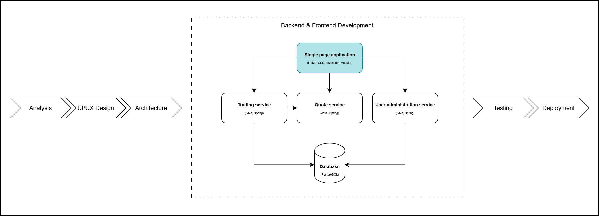

# Frontend Development: Signals, Observables and Forms



## Table of contents

- [Signals and streams: the idea](#signals-and-streams-the-idea)
- [Observables](#observables)
- [RxJS operators](#rxjs-operators)
- [From Observable to signal: toSignal](#from-observable-to-signal-tosignal)
- [From signal to Observable: toObservable](#from-signal-to-observable-toobservable)
- [Inputs and outputs as functions](#inputs-and-outputs-as-functions)
- [linkedSignal](#linkedsignal)
- [OnPush](#onpush)
- [Forms and Validations](#forms-and-validations)

The basics of signals (`signal`, `computed`) and reactive forms are in the [Theory of the previous laboratory](../../06_Frontend_Development/Theory/README.md#signals-the-basics).

## About Angular - part II

### Signals and streams: the idea

- The dashboard shows data that keeps changing: rates every two seconds, new transactions, the filters the user picks.
- **Signals** hold the state the screen shows: the filters, the rows, the rate of each widget. Everything the template reads is a signal.
- **Observables** bring the data in from the server. `HttpClient` returns them, and polling every two seconds is an Observable too.
- Two functions connect the two: `toSignal` turns a stream into state for the template, and `toObservable` turns state into a stream when a change must start new work.

```
 server --HTTP/polling--> Observable --toSignal--> signal --> template
```

### Observables

- An Observable is a source of values that arrive over time: one HTTP answer, or a new value every two seconds.
- It is **lazy**: nothing happens until somebody subscribes. And it can be **cancelled**: unsubscribing stops the work.

```TypeScript
const ticks$ = interval(1000);                         // 0, 1, 2, ... every second
const subscription = ticks$.subscribe(n => console.log(n));
subscription.unsubscribe();                            // stop
```

- An Observable can send three things: a value (`next`), an error (`error`), or "I am done" (`complete`). An HTTP call sends one value and completes; `interval` never completes.
- The `$` at the end of a name is a convention meaning "this is an Observable".
- In the dashboard you almost never call `subscribe` yourself: `toSignal` does it for you and also unsubscribes.

### RxJS operators

Operators change a stream without touching its source. They go inside `.pipe(...)`. The dashboard uses these:

| Operator | What it does |
| ------------- | ------------- |
| `interval(2000)` | emits 0, 1, 2, ... every two seconds |
| `startWith(0)` | emits one value immediately, before the others |
| `switchMap(...)` | for each value, starts a new inner stream and cancels the previous one |
| `map(...)` | changes each value |
| `catchError(...)` | handles an error, so it does not reach the subscriber |

The polling in `TradeService` combines three of them:

```TypeScript
getTransactionsPolling() {
  return interval(2000).pipe(
    startWith(0),                                         // ask now, do not wait two seconds
    switchMap(() => this.http.get(backendUrl.fxTradeService.getTransactions))  // a new request every tick
  );
}
```

- `switchMap` is the one to remember: if a new tick comes while the last request is still running, the old request is cancelled.
- To see how operators behave over time, try https://rxmarbles.com/.

### From Observable to signal: toSignal

`toSignal` subscribes to an Observable and gives you a signal that always holds the latest value:

```TypeScript
currencies = toSignal(this.tradeService.getCurrencies(), { initialValue: [] as string[] });
transactions = toSignal(this.tradeService.getTransactionsPolling(), { initialValue: [] as Transaction[] });
```

- The template reads `transactions()` like any signal, and the rows update every two seconds.
- `initialValue` is what the signal holds before the first answer arrives.
- `toSignal` **unsubscribes when the component is destroyed**: no `ngOnDestroy`, no leaked polling.
- If the Observable fails, reading the signal throws. Catch errors inside the `pipe` with `catchError`.

### From signal to Observable: toObservable

When a change of state must start new work over time, turn the signal into a stream with `toObservable`. In the widget, picking a new currency pair must stop polling the old pair and start polling the new one:

```TypeScript
rates = toSignal(
  toObservable(this.pair).pipe(                  // a stream of the chosen pair
    switchMap((pair) =>
      pair
        ? this.tradeService.getFxRatePolling(pair.primary, pair.secondary).pipe(
            startWith(null),                     // clear the old pair's rate at once
            catchError(() => {                   // a failed poll shows a message
              this.toastr.error('Could not load the rates!');
              return EMPTY;                      // and ends only this pair's poll
            })
          )
        : of(null)
    )
  )
);
```

```
 pair (signal) --toObservable--> switchMap: poll THIS pair --toSignal--> rates (signal) --> template
```

### Inputs and outputs as functions

- A child component receives data with `input()` and sends events with `output()`. An input is a signal, so you read it with `()`.

```TypeScript
export class WidgetComponent {
  widget = input.required<Widget>();    // the parent must pass it
  index = input.required<number>();
  currencies = input<string[]>([]);     // optional, with a default
  deleted = output<number>();           // an event going up

  onDelete() {
    this.deleted.emit(this.index());
  }
}
```

```HTML
<app-widget [widget]="widget" [index]="i" [currencies]="currencies()" (deleted)="onDeleteWidget($event)"></app-widget>
```

- A required input is checked when the app is built: forget `[widget]` and the build fails.
- An input is read-only inside the child. If the child needs to change the value, it keeps its own copy with `linkedSignal`.
- Older code uses `@Input()` and `@Output()` with `EventEmitter` for the same thing.

### linkedSignal

- A `linkedSignal` is a signal that starts from another value, can be changed with `set`, and starts over when the value it follows changes.
- The widget uses it to keep its own copy of the parent's data, so the user can change the currency without touching the parent's object:

```TypeScript
widget = input.required<Widget>();
primaryCcy = linkedSignal(() => this.widget().primaryCcy);

this.primaryCcy.set('EUR');   // allowed: it is the widget's own state
```

- It can also see its previous value. The widget uses that to show whether the rate went up or down since the last tick (`buyTrend`, `sellTrend`).

### OnPush

- With `changeDetection: ChangeDetectionStrategy.OnPush`, Angular redraws a component only when one of its inputs changes, one of its events runs, or **a signal its template reads changes**.
- When everything the template shows is a signal, the component updates exactly when it should and Angular does less work. The dashboard components use `OnPush`.

### Forms and Validations

- The login and register pages use **reactive forms**, explained in the [previous laboratory](../../06_Frontend_Development/Theory/README.md#reactive-forms).
- The dashboard's small inputs (the blotter filters, the widget's notional and tenor) use `ngModel`, the **template-driven** way: the template binds the input directly to a value.
- With signals, write the binding in two halves, reading the signal and setting it on every change:

```HTML
<input [ngModel]="ccyPair()" (ngModelChange)="ccyPair.set($event)" />
```

- Template-driven forms are quick for one or two fields. For a whole form with validation, use reactive forms.
